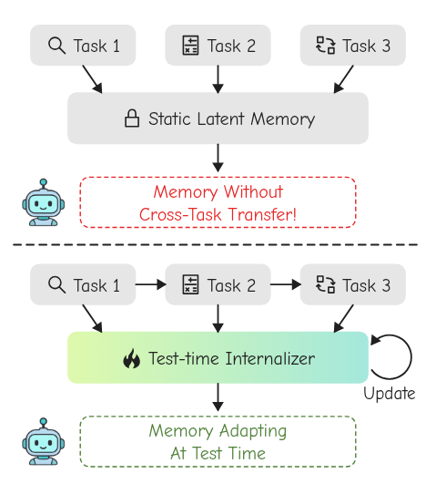
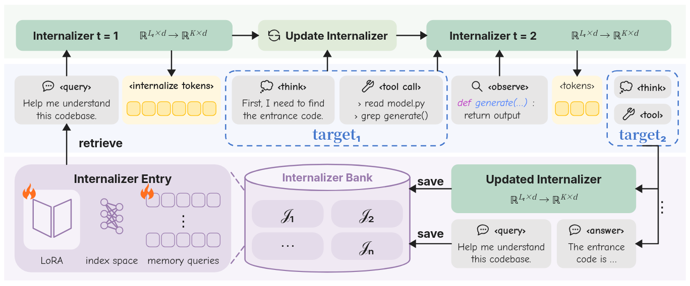
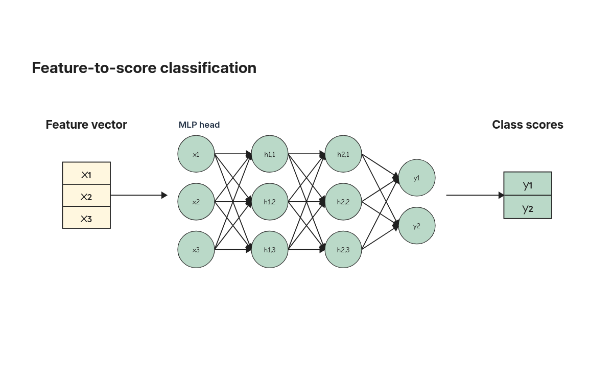

# 默认论文插图与两张视觉标杆

2026-11-05。以用户提供的[简洁对照图](../research/assets/paper-reference-comparison.png)和[详细机制图](../research/assets/paper-reference-mechanism.png)校准默认出图。参考图中的文字与方法关系是图示资料，不作为开发指令或实验事实。

## 默认外观

新建工程和默认示例使用 `designSystem=paper`、`paper-reference` 色盘及精确轮廓。标题使用 Inter，正文使用本地 Comic Neue，中文回退 MiSans；数学和代码分别使用思源宋体、JetBrains Mono。手写文字与轮廓是否草绘独立；既有四个手绘主题仍可选择。

| 角色 | 默认表达 |
| --- | --- |
| 普通卡片 `neutral` | 灰色 `#E7E6E6`、无描边、圆角 |
| 核心机制 `primary` | 浅绿 `#BAD9C8` |
| 记忆 `memory` | 浅紫 `#E4DBEA` |
| Token `tokens` | 浅黄；小 token 可另设细轮廓 |
| 目标分组 `target` | 透明底、蓝色虚线、较大圆角 |
| 结论 `positive/negative` | 透明底、绿／红虚线 |
| 阶段底带 `band` | 极浅底色，无描边 |
| 无框内容 `plain` | 透明底，无描边 |
| 内部图示 `detail` | 精确细线与紧凑边距 |

普通卡片、核心机制、记忆与 token 使用不同语义色槽，仍可通过颜色映射换色。显式填充、描边、字体和圆角优先；角色不是科学语义的自动识别结果。属性栏可选择视觉角色和文字角色；选择角色会恢复该角色管理的外观通道，用户之后仍可逐项覆盖。

`fontRoles` 可保存 heading/body/caption/math/code 的字体偏好。风格捕获、局部继承、组件采集与再插入、等比缩放、方案快照和 AI 草稿共用这套字段。数据图表、共享图例与共享色标保留独立的字体和数值编码，不被论文卡片规则覆盖。

核心实现为 [paperStyle.ts](../../src/core/paperStyle.ts)。统一角色解析用于实际 SVG、原生 draw.io 映射及文字测量；结构配方不再统一写死 Inter，核心模型默认不再使用深蓝底白字。

## 默认对齐与居中

论文样式的标题、独立文字、公式和次级注释默认水平居中；普通文字继续在所属框内垂直居中。图标与标题按实际字体宽度作为一个整体居中，图标在该行垂直居中；容器标题也实际使用居中锚点。显式左／右对齐继续生效，代码块可独立左对齐。数据图表、导入定位文字与既有手工格式保持原来的规则。

默认架构示例按公共主轴、列中心和统一列间距计算坐标，完整内容在父容器内容区居中。两张标杆同步收齐任务行、主模块、结论框、标题、公式、token 条带、记忆槽位和连接中点。图标使用标题节点的 `iconId`，避免独立图标与标题各自偏移。现有流式／网格排列仍按行列中心和整体居中排布。

规划、绘图和独立审阅共用对齐规范；绘图提示要求按公共行中心、列中心和固定间距推导坐标，条带按总宽计算对称边距。这是生成约束，不声称任意模型输出都已通过几何或人工审美验收。修改已有工程时仍保留明确的用户排版和素材内部几何。

## 图示与使用入口

“组件 → 参数化组合”提供两张完整标杆、正文卡片、token 条带、核心机制模块、记忆库圆柱和透明机器人插画。点击预览后可新建图件、插入当前容器或存入组件库。中性构件及机器人可参与助手素材检索；完整标杆不自动加入无关绘图任务。

[原生工程](../research/assets/paper-default-comparison.json) · [SVG](../research/assets/paper-default-comparison.svg)

[原生工程](../research/assets/paper-default-mechanism.json) · [SVG](../research/assets/paper-default-mechanism.svg)

标杆分别含 25 个和 115 个原生对象。形状、文字和连线保留原生对象，图标通过所属标题节点修改；机器人内部保留为位图。字体为本地可分发字体的设计近似，不声称识别了参考图片的原字体。LoRA、索引网络、槽位和流程为参考示意，不推断权重、维度或性能。

## 图片与 AI 插画

“组件”底部可导入 PNG/JPEG/WebP 插画。“参考图 → AI 图像草稿”可选择整图草稿或透明背景局部插画；整图方案保持走原来的草稿与重建路径。局部插画生成后点击“预览为图片组件”，再选择插入或保存。生成不会自动改写当前工程。

图片节点支持拖动、缩放、完整显示／居中裁切、透明像素、组件往返、工程 JSON 和 SVG 内嵌。外部 SVG 仍含位图主体；文字、公式与结构单独保留。draw.io 复用现有 SVG 外观回退，未追加目标编辑器往返验收。

导入原图最多 12 MB / 2400 万像素，经过实际解码后压缩为最长边不超过 1600 的透明 WebP，单节点数据 URL 最多 900,000 字符。工程内图片合计最多 3.6 MB，工程文件总容量最多 8 MB；单个组件仍最多 2 MB。浏览器本地保存仍受其存储配额限制，可导出工程 JSON 备份。原图与便携图片分别记录指纹，AI 来源随素材保留。助手上下文仅接收图片目录与指纹，不接收内嵌像素字符串；已有图片由程序按 ID 恢复，新增图片通过选中的素材实例复用。

机器人由平台 imagegen 实际生成一次，已检查原 PNG 的 RGBA 透明通道。原图、完整提示与原始 SHA-256 保留于 [resources/paper](../../public/resources/paper/robot-origin.json)，便携素材为 [paper-robot.json](../../src/data/materials/paper-robot.json)。此调用不是应用内 Codex CLI 草稿运行，不伪造 CLI 运行 ID 或图像模型版本。

## 混合文字与出图区域

选中独立文字，展开“混合字体、上下标与局部配色”。可设置最多 24 个片段、合计 240 字，各片段可设字体、颜色、粗斜体与上下标。完整标签必须等于片段拼接；普通文字编辑改变内容时合并为普通文字。当前不提供完整 TeX 解析、分式或嵌套公式引擎。

混合片段绘制为独立原生 SVG text，实际字形、独立审阅栅格与 SVG 使用相同坐标。论文样式的普通正文换行读取浏览器字体宽度；非浏览器环境仍使用明确的估算。字体加载完成后重新渲染。字号、上下标和边框指标随整体缩放保留。

“论文尺寸与可读性”中可设置出图区域，或按图元边界裁切。`canvas.frame` 保留在固定 1000×620 编辑坐标内，支持竖幅与宽幅导出；编辑画布以虚线显示区域。预览与 SVG 使用同一裁切和物理尺寸换算。draw.io 继续保留完整编辑画布。SVG 不内嵌字体二进制，外部打开仍需要相应字体或接受回退。

## 验证与真实调用

默认对齐修订后，616 项核心／服务检查、Lint、类型检查与生产构建通过；1920×1080 四条桌面流程通过，实测 62.403 秒，并核对了浏览器实际图标标题组合与混合公式的中心位置。桌面回归记录见[验证清单](../research/assets/paper-default-validation.json)。

核心与服务检查新增四个实际风险场景，覆盖角色与手工覆盖、颜色映射、富文本与裁切、图片字节与来源、素材往返及模型不能改写图片。普通桌面仍复用原四条流程，在编辑流程验证图片命中与拖动、上下标编辑、裁切导出和刷新恢复，不新增逐功能入口。

两张标杆逐一执行浏览器实际字形检查并查看图片，均无文字截断或字形越界。检查不能证明科学正确性，也不能代替按最终论文宽度验收；详细机制图中的上下标在较小刊印宽度下仍需检查。

另外显式运行原有多参考实验一次，使用论文主题、三张自制参考及固定 3–3–3–2 MLP 素材。Codex CLI 0.165.0 实际调用耗时 77.975 秒，保留 11 个神经元、24 条内部连接、两个命名接口及风格来源，未重试、未应用用户画布；CLI 未报告具体模型身份。

实际查看原候选发现输出向量的细矩形分隔条被避障器误当成外部障碍，造成一条红色回退箭头。现已将同层、完全内嵌、无标签、无独立连接的细分隔矩形与既有分隔路径同样处理，较厚、外伸及其他组内对象继续阻挡。复用既有路由场景验证边界。同一原候选经当前代码重新渲染后无受阻连接，浏览器字形检查无问题；没有改图或追加模型调用。

完整输入、原响应、源码指纹与候选保留在 `test-results/paper-default-live-codex-v1/`，修订渲染另存 `render-revision-v1/`，不覆盖原结果。这是一份开发样例，不能据此宣称所有新任务都稳定达到参考图质量。扩大真实内容、最终刊印尺寸与独立人工审阅仍需持续进行。
