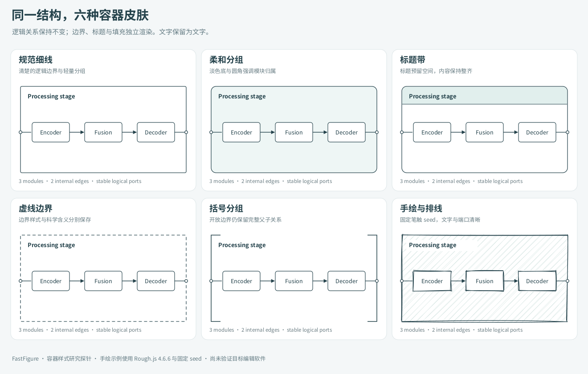

# 科研图容器与可定制样式

FastFigure 面向计算机科研图的收集、重绘、组件复用、生成与迭代。PDF、扫描件格式化和文档解析系统只作为参考方案，不建设 PDF 产品、页面工作台、搜索文字层或全文重排功能。

容器和样式进入核心分析范围。建议将容器的科学含义、布局和外观分开表达，同一结构可以应用规范框图、手绘、标题带、虚线分区等皮肤。LLM 提出组件和样式参数，确定性渲染器生成外观，文字、拓扑和编辑验证负责验收。

研究日期为 2026 年 10 月 28 日。本文包含技术资料分析、设计建议和一个本地 SVG 渲染探针；渲染探针不代表已完成编辑器或验证过 PPTX/draw.io 兼容。来源与依赖版本见 [样式来源索引](container-style-sources.json)。

## 1 容器包含语义、布局和皮肤

| 层 | 需要表达的内容 | 示例 |
| --- | --- | --- |
| 科学含义 | 所属阶段、模块、参与方、环境、边界性质 | 训练阶段、推理服务、可信域、客户端、GPU |
| 结构与行为 | 父子对象、端口、跨边界连线、移动与选择规则 | 移动容器带动子图，边仍绑定原对象 |
| 内容布局 | 标题区、padding、槽位、对齐、行列或分区 | 双分支融合、流水线、泳道、算子树 |
| 视觉皮肤 | 边框、圆角、排线、标题带、角标、括号、笔触 | 手绘边框、淡色标题、虚线轮廓 |

科研图中的分组框通常允许边跨越边界；画板式 frame 可能裁剪子内容；协议泳道还有参与方和时序含义。它们不能只用一个带不同边框的矩形混合表示。建议区分 `group`、`module`、`boundary`、`lane`、`panel` 等角色，角色再选择皮肤。

默认科研分组不裁剪内容，必要时提示溢出；截图视窗等明确需要裁剪的对象单独设置策略。信任边界使用虚线是一个可选视觉编码，但 `trusted/untrusted` 等含义应有独立字段与图例，避免换皮肤时丢失科学信息。

## 2 可参考的现有方案

| 方案 | 一手资料确认的能力 | 在 FastFigure 中的合适位置 | 仍需建设的部分 |
| --- | --- | --- | --- |
| [Rough.js](https://roughjs.com/) | Canvas/SVG 图元、曲线和路径的手绘渲染 | 手绘皮肤的底层生成器 | 容器语义、布局、端口、文字和编辑模型 |
| [Rough.js 参数](https://github.com/rough-stuff/rough/wiki) | roughness、bowing、seed、填充方式、排线角度与间距 | 可存储、可调节的笔触参数 | 参数上限、最终尺寸与可读性约束 |
| [draw.io 样式参考](https://www.drawio.com/docs/reference/diagram-generation/style-reference/) | 原生容器、父子坐标、标题区与 sketch 相关样式 | 可编辑格式适配和样式往返的重点原型 | 与 FigureIR 的语义映射及真实编辑验收 |
| [Excalidraw 元素模型](https://raw.githubusercontent.com/excalidraw/excalidraw/master/packages/element/src/types.ts) | 图元分别记录笔触、填充、seed、分组和绑定 | 参考手绘对象的持久化方式 | 复杂科研容器、布局与多格式编译 |
| [tldraw ShapeUtil](https://tldraw.dev/docs/shapes) 与 [形状体系](https://tldraw.dev/sdk-features/shapes) | 自定义属性、几何、渲染、交互及父子关系；frame-like 能力 | 需要深度自定义科研对象时评估的编辑框架 | 自己的科研对象库、渲染器与导出器 |
| [React Flow 子流程](https://reactflow.dev/learn/layouting/sub-flows) | 父子节点相对定位、分组与范围限制 | 系统结构与流程型容器的交互参考 | 通用科研画布和可编辑文件编译 |

Rough.js 官方提供无 Canvas 的 generator，能够生成可序列化的绘制指令和 SVG path，适合离线渲染、缓存与版本化。[Generator 文档](https://github.com/rough-stuff/rough/wiki/RoughGenerator)。

Excalidraw 的 [Customizing Styles](https://docs.excalidraw.com/docs/@excalidraw/excalidraw/customizing-styles) 主要说明编辑器界面的 CSS 变量。图内对象的笔触与填充需要通过元素属性处理，不能把编辑器主题配置当成图件样式接口。[initialData 示例](https://docs.excalidraw.com/docs/@excalidraw/excalidraw/api/props/initialdata)。

## 3 首批样式覆盖

建议先定义下列六种皮肤，使用同一结构做比较，再按真实论文需求增加变体。这里的“手绘”只指定可控的外观特征，正文无需统一换成手写字体。

| 皮肤 | 核心参数 | 重点检查 |
| --- | --- | --- |
| 规范细线 | 线宽、圆角、纯色或无填充 | 缩小后的边界层级与文字清晰度 |
| 柔和分组 | 低饱和底色、圆角、边框 | 灰度下可区分，嵌套后背景不过深 |
| 标题带 | 标题高度、位置、颜色、分隔线 | 长标题换行、内容区自动让位 |
| 虚线边界 | dash、gap、边界间距 | 跨边界连接和语义编码不混淆 |
| 括号分组 | 左/上括号、标题位置、边距 | 括号只作分组装饰，不被识别成数据连线 |
| 手绘与排线 | roughness、bowing、填充、排线、稳定 seed | 笔触不遮挡文字、端口和箭头 |

后续可以增加双线框、叠层卡片、折角、分栏、嵌套泳道以及 tensor 等组件的手绘皮肤。阴影和纹理应作为独立可关闭参数；不先依赖整图滤镜完成风格转换。

对照图由同一组三模块与连接关系生成；六张图只更换皮肤。手绘示例调用 Rough.js 4.6.6，其余使用基础 SVG。文字仍是 SVG text，图片只用于预览。



[矢量对照图](assets/container-style-comparison.svg) · [生成脚本](examples/render-container-styles.cjs)

## 4 样式契约

建议按工程主题、容器角色、组件类型和实例覆盖四层解析。风格引用保存版本，便于批量修改与复现。最小示意如下，尚不是正式 schema：

```json
{
  "id": "training-stage",
  "kind": "container",
  "role": "stage",
  "children": ["encoder", "fusion", "decoder"],
  "layout": {
    "kind": "row",
    "paddingPt": 12,
    "titleReservePt": 20,
    "clipChildren": false
  },
  "ports": [{"id": "input", "side": "left", "position": 0.5}],
  "style": {
    "presetRef": "sketch-light@1",
    "seed": 38191,
    "overrides": {"roughness": 0.6, "fillStyle": "hachure"}
  }
}
```

容器同时计算三种范围：逻辑边界负责布局与端口；装饰范围包含手绘外延、线宽和阴影；内容范围包含文字与子对象。选择、路由和导出时分别使用适合的范围，避免把笔触抖动当成真实几何变化。

颜色、字体、线宽和排线密度使用样式令牌，必要时分别指定容器、内部组件和连接的令牌。图例与科学含义使用的颜色或线型可以锁定，批量换主题时保留这些约束。

## 5 手绘渲染的工程细节

1. **稳定随机性。** 每个对象与装饰层保存非零 seed，在局部坐标生成路径，再做整体变换。只移动容器时复用路径；参数改变时再生成受影响的部分。固定 seed 只保证相同参数和实现下可复现；精确重开还需要保存渲染器版本和生成路径。
2. **保留连接锚点。** 端口属于逻辑模型。连线笔触可以轻微变化，端点与箭头定位需要受约束，连接绑定始终引用原节点与端口。单靠随机曲线参数不能保证绑定正确。
3. **保留文字层。** 默认用清晰字体排正文与公式，允许标题另选字体。排线置于内容下层，文字和端口附近留保护区；不要通过整图纹理让小字变糊。
4. **控制嵌套。** 容器填充透明度不与子内容透明度混用；内外层可以改变边框或标题层级，避免每层叠加排线、双线和阴影。
5. **按最终尺寸检查。** 粗糙度、排线间距和线宽是有尺度的参数。缩小交付尺寸后，应检查细线、密集排线和箭头是否仍可辨认，再决定是否重算样式。

Rough.js 的 seed 设计和参数范围支持可复现生成，但稳定的对象级笔触、端口行为和最终尺寸约束需要 FastFigure 自己实现。[参数说明](https://github.com/rough-stuff/rough/wiki)。

## 6 与重绘和组件库结合

重建已有手绘图时，先恢复底层模块与关系，再估计皮肤：框线是手绘外观还是开放边界，排线属于填充还是内容，重复笔触是否属于同一个框。候选图中把可辨识文字、真实边和装饰线分开标记。

保留两种不同的任务意图：忠实重建原图外观；保留内容与拓扑并换为指定样式。后者允许外观差异，评价时需要与内容规格和目标样式对照，不能只以原图像素相似度筛选结果。

素材库继续保留结构、布局和样式三类可组合资产。将新发现的手绘风提炼为一组样式参数和容器适配规则，可与已有组件组合；只有视觉特征无法参数化表达的局部才考虑独立素材或新的渲染适配器。

使用 GPT Image 时，可明确参考职责：一张提供布局，一张提供容器边界和填充风格。回收时再把结构与样式拆开，检查生成草稿是否改了文字和连线。规则明确的手绘框可直接程序渲染，图像生成主要用于探索尚未确定的视觉语言。

## 7 各格式分别验证

| 目标 | 建议表示 | 能保证什么需要实测 |
| --- | --- | --- |
| FigureIR 工程 | 语义对象、端口、样式参数、seed 与缓存路径 | 重开、换风格、移动与局部修改 |
| SVG | 分组、text、逻辑元数据和装饰 path | 外观与文字保留；普通 SVG 编辑器不会自动理解我们的容器语义 |
| draw.io | 原生 cells、容器、端口/边引用、可映射的 sketch 样式 | 内外坐标、移动绑定、样式参数及重开的一致性 |
| PPTX | 原生文字、支持的形状/连接器；手绘边界可作独立自由路径或向量装饰 | 视觉保真、文字可改、绑定可用及分组行为分别报告 |

PPTX 中把手绘边界作为装饰路径保留下来，不自动意味着编辑边界后能重新生成相同风格；复杂容器还需要工程源文件支持。图片式 fallback 应按对象记录，不能把整个容器或整图图片化后计入原生编辑成功。

draw.io 官方列出 sketch、填充和抖动参数，并有容器/父子关系机制。这是实施候选的依据，不足以证明与我们的样式模型可以无损往返。[官方样式参考](https://www.drawio.com/docs/reference/diagram-generation/style-reference/)。

## 8 样式也进入 RSI

建立“同一结构、多个皮肤”的已知答案数据。文字、对象 ID、分组、端口和边保持不变，程序只改变样式，用来检查重绘器是否把排线和双笔触识别成额外边，或因手绘外观而漏掉小字。

错误池增加以下类型：装饰误识别为拓扑、手绘线重复成多个对象、文字受纹理影响、端口被笔触遮挡、嵌套样式失控、长标题侵入内容、换主题改变语义颜色、导出后绑定或样式丢失。

组件程序可针对错误改进标题测量、保护区、纹理密度和参数范围。LLM 提出改动，程序验证前后内容与拓扑不变，再检查最终尺寸可读性与跨格式编辑；人工或独立视觉评价负责风格是否合适。

建议先取 12 类代表容器/结构、6 种皮肤，形成 72 个基础组合，再加入长标题、嵌套、缩小、移动和保存重开任务。按底层结构及来源谱系划分开发与验收，避免同一结构的另一种颜色或皮肤泄漏到验收集。这是拟定实验规模。

样式评分与内容评分分别报告。风格评价可以衡量参考接近度、可读性和人工修改时间；文字和拓扑采用明确约束。程序生成数据只是其中一部分，真实手绘参考图和真实论文图用于检查泛化。

## 9 建议研发顺序

先确定容器语义、布局、端口和样式引用；用基础 SVG 建立规范皮肤，再用 Rough.js 验证轻度手绘与排线。随后验证同一结构的切换、移动、长标题和重开，最后做 draw.io 与 PPTX 的能力映射。

对于论文框图，优先选择清楚、可编辑、参数稳定的轻度手绘方案，同时保留较强手绘风用于构图探索和其他展示用途。具体默认值通过真实图件与最终尺寸对照确定，不把某一种视觉风格描述为所有会议和期刊的统一要求。
