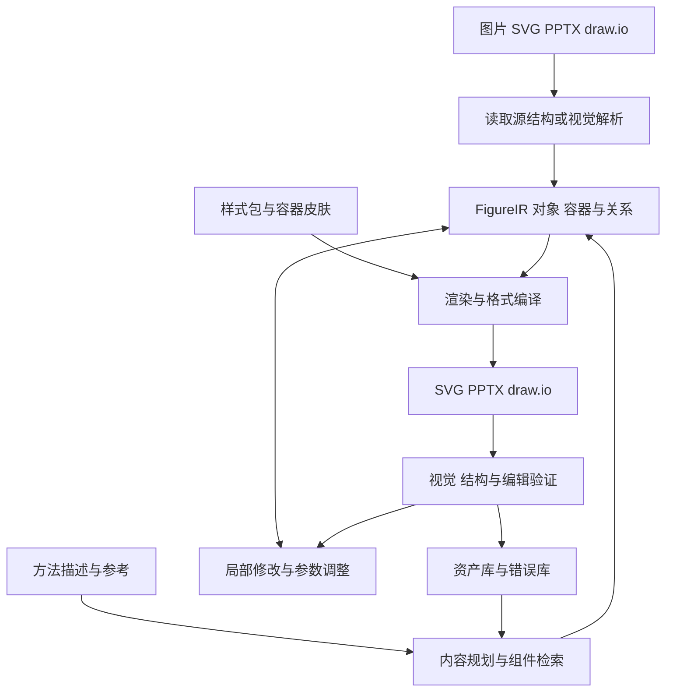

# FastFigure 产品与技术方案

这是依据 2026 年 10 月 28 日调研提出的研发方案。工具能力与出处见 [调研报告](2026-10-28-landscape.md)。下述范围、架构、质量门槛和周期均为建议，尚不是已完成的产品能力或实测结果。

**产品范围是计算机科研绘图：收集与重绘 → 参数化素材库 → 检索或图像草稿生成 → 校验回收 → RSI。** 容器、分组、端口和可定制样式属于核心对象；手绘风与规范框图风可作用于同一结构。PDF、扫描件格式化和全文重排工具仅作参考，不设置对应产品入口、独立文档模型或研发任务。

细化设计见 [计算机图件素材库](2026-10-28-cs-figure-library.md)、[矢量化与 RSI](2026-10-28-vectorization-rsi.md) 和 [容器与样式](2026-10-28-container-styles.md)。第一版围绕图件重建、组件复用、局部修改、样式切换和原生导出验证。

## 1 产品入口

| 入口 | 用户提供什么 | 首次交付 | 后续动作 |
| --- | --- | --- | --- |
| 重建已有图 | 论文图截图、SVG、已有 draw.io 或 PPTX | 参考图与可编辑草稿并排展示，标出需要检查的对象 | 改字、换模块、移动节点、修改连接、统一风格 |
| 从描述创建图 | 方法段落、要表达的模块与关系、草图或风格参考 | 可修改的内容大纲和图草稿 | 确认科学内容后调整布局与样式 |
| 装配论文图件 | 数据图、图片、标注和面板要求 | 统一尺寸、字体和编号的多面板 figure | 更新某个面板数据，重排整组图件 |
| 定制图件样式 | 已有图结构、容器类型与风格参考 | 规范、手绘、标题带、虚线边界等可切换预览 | 批量改样式、局部覆盖、保存样式包 |

交互应围绕科研修改表达，例如“把 encoder 拆成两级”“保留所有连线，只修改这一组标签”“把 a、b、c 三个面板统一字体”。实现中的 OCR、分割模型或 XML 类型放在诊断面板，避免增加日常使用负担。

## 2 第一版范围

| 优先级 | 能力 | 可检查的交付标准 |
| --- | --- | --- |
| P0 | 图片与已有矢量图件导入 | 保留原件、来源与尺寸，优先利用已有源结构 |
| P0 | 方法图对象恢复 | 文字、矩形、圆形、路径、箭头、分组进入对象清单；低置信区域可人工修正 |
| P0 | 局部编辑 | 改文字、颜色、位置、大小、层级；修改时保留稳定对象 ID |
| P0 | 原生连接关系 | 支持的节点移动后，连接器端点跟随；跨格式后再次执行同样检查 |
| P0 | 保存源工程 | 保存 FigureIR、素材和版本；重新打开继续编辑 |
| P0 | SVG 输出 | 支持的文字保持为文字；图像按最终物理尺寸检查清晰度 |
| P0 | PPTX 和 draw.io 输出 | 对支持的对象生成真实文字、形状与连接关系；不能转换的区域有明确表示 |
| P0 | 参考对照 | 原图、结果、差异与待检查对象可对应定位 |
| P0 | 容器与样式契约 | 父子关系、边界端口、标题区、逻辑几何和装饰笔触分开保存 |
| P0 | 参数化科研组件与素材库 | 计算机类组件可检索、改参数、组合和保存谱系 |
| P1 | 文本生成与科研模板 | 从内容大纲直接生成结构草稿，支持风格参考 |
| P1 | 数据图与多面板 | 数据源驱动刷新、统一 panel 标签、尺寸和排版 |
| P1 | 可定制样式包 | 规范、手绘、标题带、虚线与分区等预设；跨格式编辑能力分别验证 |
| P2 | 高级互操作 | 大范围 PPTX 反向导入、复杂公式、复杂曲线与协作 |

截图、实拍输入与实验结果图可以作为独立图像素材保留，标注单独编辑。第一版优先验证科研框图、组件和样式，不以任意照片全矢量化、完整 Office 双向同步或自训练模型为前提。

## 3 图件对象模型与可执行素材

使用 FigureIR 保存图件内容、父子关系、端口、布局与样式引用；AssetStore 保存原件、组件程序、参考图、样式包和版本。容器的逻辑几何负责连接、布局与选择；装饰几何负责手绘笔触等外观。



FigureIR 是工程源格式；SVG、PPTX 和 draw.io 是编译目标。这样可以保留显式连接关系和科研组件参数，同时让同一结构应用不同样式。

### 3.1 FigureIR 的建议字段

| 对象 | 最小内容 |
| --- | --- |
| Document | schema 版本、画布尺寸、物理单位、样式主题、字体清单 |
| Text | 原文、富文本 runs、字体、字号、对齐、边界与测量结果 |
| Shape | 几何类型、坐标、变换、填充、描边与层级 |
| Node | 模块类型、标签、端口、参数和所属容器 |
| Edge | source/target 对象与端口、方向、标签、折点、路由策略 |
| Group、Container 与 Panel | 子对象、局部坐标、语义角色、标题区、padding、逻辑边界、边界端口与裁剪策略 |
| Style | 样式包版本、令牌、对象覆盖、笔触 seed、渲染器版本、装饰外延 |
| Asset | 文件引用、像素尺寸或 viewBox、裁剪、来源、许可、是否锁定 |
| Chart | 数据引用、图表定义、绘图代码或配置、渲染结果 |
| Formula | LaTeX 或其他语义源、可视输出、目标格式支持情况 |
| Provenance | 源文件指纹、页码、原图区域、识别来源、置信度、人工校对状态 |

文字框、模块标签和图结构的关系要明确。例如 node 可以引用 text 对象，而不是保存两份互不关联的标签。几何建议内部统一使用 pt；输入图像保存像素坐标到画布的变换，避免把任意截图分辨率当成物理尺寸。

下面只是用于讨论数据模型的示意，不是已实现的 schema：

```json
{
  "schemaVersion": "0.1-proposal",
  "canvas": { "width": 510, "height": 260, "unit": "pt" },
  "nodes": [
    { "id": "encoder", "kind": "module", "labelRef": "label-1", "box": [40, 80, 130, 70], "ports": ["out"] },
    { "id": "decoder", "kind": "module", "labelRef": "label-2", "box": [300, 80, 130, 70], "ports": ["in"] }
  ],
  "texts": [
    { "id": "label-1", "text": "Encoder" },
    { "id": "label-2", "text": "Decoder" }
  ],
  "edges": [
    { "id": "edge-1", "source": ["encoder", "out"], "target": ["decoder", "in"], "arrow": "end" }
  ]
}
```

### 3.2 编辑与版本

模型优先输出受约束的对象或 patch，再由确定性代码测量、布局和编译。一次修改记录选择范围、旧值、新值与版本，允许撤销。被锁定的面板、文字、数据、素材或连接应保留。

对跨工具修改，第一版使用显式导入新版本的方式。FastFigure 保存对象 ID，支持范围内的 draw.io 编辑可映射回 IR；不支持的对象保留为 external asset 并说明转换范围。不要许诺任意 PPTX、draw.io、SVG 往返都无损。

## 4 按输入选择重建路径

### 4.1 有原生结构的输入

1. 检查 draw.io 文件或图像是否携带 XML，直接恢复图模型。
2. 对 PPTX 读取真实文字、形状、连接器、图像、分组和坐标。
3. 外部工具从论文 PDF 提取的文字、路径与裁剪图可以作为离线素材输入；只借助其中可用的图件证据。
4. 对 SVG 解析安全且可支持的图元子集，保留真实文字；复杂效果先保留为独立对象。
5. 给每次直接提取与推断标注来源，便于用户判断哪里需要检查。

优先保留已有图件结构。文字已转为路径或缺少可靠映射的区域，再使用 OCR 与视觉推断。

### 4.2 栅格方法图

1. 识别面板、容器、文字区域、基础几何、图标和图像区域。
2. 使用带坐标 OCR 获取文字，用视觉模型补充模块含义和关系候选。
3. 对箭头与线段结合几何、箭头头部、交叉点和节点邻近关系恢复候选边。
4. 区分“线相交”和“有连接”，区分“没有箭头”和“双向箭头”。
5. 基于位置、包含、端口、方向与语义约束校验图结构。
6. 复杂图标按独立素材保留，或经用户选择后做向量化；基础形状和文字优先原生重建。
7. 先固定内容与拓扑，再修颜色、间距、字体和路径细节。

分割模型擅长找区域，但区域掩码本身不能给出可编辑的连线端点。选择 SAM 系列或其他分割器时，评估的是它对对象恢复的实际增益，而不是把分割结果直接等同于图结构。

### 4.3 从文本生成新图

先从段落生成科学内容清单，包括模块、输入输出、顺序、并行与反馈关系。让用户能检查这份大纲，再生成布局和样式。参考图主要提供构图与视觉风格，不默认复用其中的实验事实、数字或结论。

可支持先生成视觉底稿再重建的创作模式，但无需让所有新图都先经过一次栅格化。结构明确的方法图可直接由 FigureIR 编译，并使用渲染结果迭代改善布局。

## 5 导出器分别实现

### 5.1 SVG

- 文本优先使用 text/tspan，不统一转路径。
- 对常用对象限定可移植的几何、填充、描边与裁剪能力；复杂效果有单独的保真交付选择。
- 字体和公式源随工程保存；检查缺字、替换和字体嵌入条件。
- 按目标物理尺寸检查样式；手绘边界保留独立路径，正文文字和连接仍保留其语义。
- 投稿规范作为带来源日期的 preset；不把某一家期刊规则当成所有期刊规则。

投稿预设按实际目标计算机会议或期刊的规范和版本维护；容器手绘风等视觉皮肤独立配置，在最终物理尺寸下验收。

### 5.2 原生 PPTX

用 PptxGenJS 或 python-pptx 创建真实 text、shape 和 chart。两者是编译器组件，不能自行解决所有视觉重建问题。[PptxGenJS](https://gitbrent.github.io/PptxGenJS/)、[python pptx](https://python-pptx.readthedocs.io/en/latest/)。

端点绑定需要专项实现与验证：支持的连接生成原生 `p:cxnSp`，并具有正确的起终点对象引用，不能只用带箭头的普通线代替。分组、自定义曲线、锚点等若库覆盖不足，使用受控 OpenXML 写入补齐。

文字导出需要测量换行、内边距、行距、字体 fallback、希腊字母与上下标。简单科学记号可保留为文本 runs；复杂公式初期以独立 SVG 加语义源保存，后续再做原生公式输出。

复杂图标允许作为单个向量或图像素材，但在产物报告中说明。图像素材不应被计算为原生可编辑图元；同时，也不应因为照片是合理的图像素材就判定整个交付失败。

Windows PowerPoint COM 可以作为特定兼容性检查或可选转换节点。云端主导出流程不依赖可见 Office 窗口。LibreOffice 可用于基础渲染回归，但它的显示结果不能替代真实 PowerPoint 的编辑验证。

### 5.3 draw.io

基础形状和标签写为原生 cells；容器保留父子关系；连线设置 source、target 和折点。复杂 SVG 图标可使用图像或 stencil 对象，清楚区分“整个图标可移动”与“图标内部图元可编辑”。

使用 draw.io embed 接入编辑器，按其 `postMessage` 协议加载与回收 XML，限制消息来源并跟踪保存状态。优先验证自托管或可控版本的接入方式。[官方 embed 文档](https://www.drawio.com/docs/reference/embed-mode/)。

对话修改交互先对照 [Next AI Draw.io](https://github.com/DayuanJiang/next-ai-draw-io)，Agent 集成先对照 [官方 draw.io MCP](https://github.com/jgraph/drawio-mcp)。FastFigure 的重点是科学内容、图结构和导出质量；这些现成系统可以缩短基础工作流的验证时间。

### 5.4 输出能力清单

每个文件附带简短的导出说明，至少回答：文字是否仍为文字，哪些对象已转为图像，哪些连接保留绑定，哪些字体有替换，目标软件中是否实际检查过。报告的依据是解析产物和编辑验证，避免从文件后缀推断能力。

## 6 容器与样式定制

容器同时保存父子层级、内容布局和视觉皮肤。基础形式包括无边框组、圆角分组、标题带、虚线边界、分区/泳道、括号式分组与手绘框；信任边界、训练阶段等科学含义另外用语义字段表达。

样式按“工程主题 → 容器角色 → 组件类型 → 实例覆盖”解析，改风格时保留节点、文字、端口与边。手绘纹理采用稳定 seed 和局部坐标；正文默认保持清楚的字体，标题可另选字体。端口锚定逻辑几何，边框、排线等装饰不参与推断连接。

首轮比较 Rough.js、draw.io sketch、Excalidraw 的图元样式及 tldraw 自定义 ShapeUtil。实现策略、格式能力和样式评测见 [容器样式调研](2026-10-28-container-styles.md)。

## 7 评测设计

### 7.1 建议样本

先建立 100 张图的工程评测集，使用有权测试和保存的源图。其中 60 张用于开发，40 张锁定为验收集，避免把调参样例当成绩。

| 类别 | 建议数量 | 主要测什么 |
| --- | --- | --- |
| 已有 SVG/draw.io/PPTX 图件 | 20 | 源结构保留、转换和编辑 |
| 清晰 PNG 方法图 | 25 | 文字、基础图元与图结构 |
| 复杂连接与嵌套图 | 20 | 交叉线、反馈、分组与遮挡 |
| 低清图件截图 | 15 | 小字、压缩、噪声与不确定性处理 |
| 数据图 | 10 | 坐标标定、数据来源、图形与文字分开 |
| 截图与结构混合图 | 10 | 系统界面局部素材与结构重建 |

同一批代表结构增加多种容器皮肤，检查切换样式后的文字、拓扑、嵌套、端口、重开和编辑。图件来源与图结构分别分组，避免样式变体跨越开发与验收集。

从第一批 20 张代表图开始跑路线对照。大集合稳定后，可研究引入 ReFigBench、PaperBananaBench 或其他公开集，先核实其可获得性、许可与任务匹配。不要只采用生成系统展示的成功案例。[ReFigBench](https://arxiv.org/abs/2609.18844)、[PaperBanana](https://arxiv.org/abs/2601.23265)。

### 7.2 同时测视觉与修改任务

| 维度 | 记录内容 |
| --- | --- |
| 文字 | 字符错误率、遗漏率、公式与上下标错误；原图不清晰的区域单独标记 |
| 拓扑 | 节点与有向边 precision/recall/F1，方向、起终点、容器包含关系 |
| 几何 | 对象位置与尺寸偏差、重叠、越界、文字溢出、连线穿过标签 |
| 视觉 | 对齐后 SSIM 或感知差异，配合人工查看；不让背景面积掩盖小字错误 |
| 原生结构 | 真实文本比例、连接器绑定比例、合理素材占比、路径数、文件体积 |
| 编辑任务 | 改标签、移动节点、加分支、替换图标、改主题、更新数据所需时间与错误 |
| 跨格式 | 保存后重开、移动节点、检查分组、缺字和字体替换 |
| 运行成本 | 首稿耗时、总耗时、重试次数、模型与计算成本、人工修正时间 |

对象数量不能单独作质量分：像素路径方案可能拥有大量对象，却缺少可用的文字与结构。也不能要求所有类别零图像：显微图和照片使用图像本来就是合理表达。

### 7.3 建议首版验收门槛

以下为内部拟定目标，需在第一轮基线测量后调整，不能对外当作已达到的成绩。

- 清晰方法图的文字字符正确率目标至少 99%，关键模块与关系由人工核对。
- 支持范围内的连接器在移动节点测试中全部保持绑定；无法可靠恢复的连接进入待检查状态。
- 已知基础图元均以原生对象导出，图像降级区域逐项列明。
- 整个交付集必须能保存、重开；不能用成功样本的平均分掩盖损坏文件。
- 在目标 Windows PowerPoint 版本和 diagrams.net 中完成编辑任务；Mac PowerPoint 与 LibreOffice 的兼容范围另列。
- 用户完成六类修改任务的中位时间，目标比从头手工重画下降至少 50%。这是产品假设，要通过对照任务检验。

不建议先规定统一 SSIM 门槛。替换字体、修正原图拼写或重新排版都可能降低像素相似度，却改善科学表达。视觉保真重建和规范化重绘应分别报告。

## 8 研发阶段与决策点

以下按 3 名工程人员可持续投入、可使用现成视觉模型与 OCR 服务估算，作为 8 至 10 周内测计划的起点。它不包含自训练模型或全 Office 兼容。PDF 与扫描件工具只作为参考资料。

| 阶段 | 预计时间 | 主要交付 | 进入下一阶段的依据 |
| --- | --- | --- | --- |
| 路线验证 | 第 1 至 2 周 | 20 张代表图、4 类基线、人工修改记录、导出能力矩阵 | 找到至少一条质量与修正成本可接受的路线 |
| 技术闭环 | 第 3 至 4 周 | FigureIR、文本与形状、基础连接、SVG/PPTX/draw.io 编译、固定字体渲染 | 支持对象能稳定保存、重开和修改 |
| 交互与识别 | 第 5 至 6 周 | 参考对照、选择区域修改、对象锁定、OCR 与图结构修正、版本撤销 | 真实用户能自主完成核心编辑任务 |
| 小规模内测 | 第 7 至 8 周 | 100 图评测、容器与样式切换、跨软件检查、导出说明 | 明确支持范围与主要失败类型 |
| 修正与扩展 | 第 9 至 10 周 | 集中修正失败类型，增加模板或数据图能力 | 根据用户使用结果选择后续投入 |

最先实现的工程任务建议如下：

1. 定义 12 至 15 类最小对象与连接结构，准备手写 FigureIR 的 10 个金样例。
2. 先让金样例同时导出到 SVG、PPTX、draw.io，并完成移动节点与修改文字测试。
3. 建立可重复的预览、字体与产物检查，把图元错误和识别错误分开。
4. 接入图件 OCR、视觉解析和已有源结构读取，输出同一种 IR。
5. 加入容器样式、对象选择、局部 patch 与人工修正，再扩展自动布局和 RSI。

先验证导出与编辑模型，可以尽早发现“识别已经成功，交付仍然不能改”的问题，避免把所有精力投入图像识别后再重做表示层。

## 9 成本与自研边界

每张图的有效成本应计算为：文件解析与 OCR、模型调用、布局与渲染、导出验证、失败重试，以及人工修正。比较路线时记录相同目标质量下的总成本，而不是单次 API 费用。

降低成本优先从输入分流、缓存 OCR 和对象识别、局部重建、限制无效迭代、确定性导出入手。复杂图先交付可修改且标出不确定区域的结果，比反复整图生成更值得测量。

| 自研核心 | 复用优先 |
| --- | --- |
| FigureIR 与科研对象含义 | OCR、文档解析与分割基础模型 |
| 图结构恢复与人工修正 | 组件渲染、排版与图件解析基础库 |
| 局部修改与一致性约束 | 通用选择、缩放、拖拽等画布基础能力 |
| 多格式语义编译与能力报告 | 基础 PPTX、SVG 与 draw.io 库 |
| 科研模板、数据来源和图件评测 | 通用素材与已有开放科学图标 |

## 10 可以形成持续积累的部分

最有价值的数据不只是原图与结果图，还包括正确图结构、用户修改动作、错误类型、成功的局部修正和目标软件中的编辑表现。经过同意并保留来源的这些记录，可逐步支持更好的重建与修改策略。

科研组件和模板应与语义对象关联：同一篇论文的颜色、字体、模块风格可统一更新；数据图能追溯到数据与程序；引用图能追溯到页码和源区域；每种导出都有已知能力范围。

产品是否值得继续投入，最终应由研究者完成修改与交付的实际时间决定。第一轮验证应围绕这件事设计，再决定扩大组件覆盖、样式定制、生成能力或 RSI 的投入。
