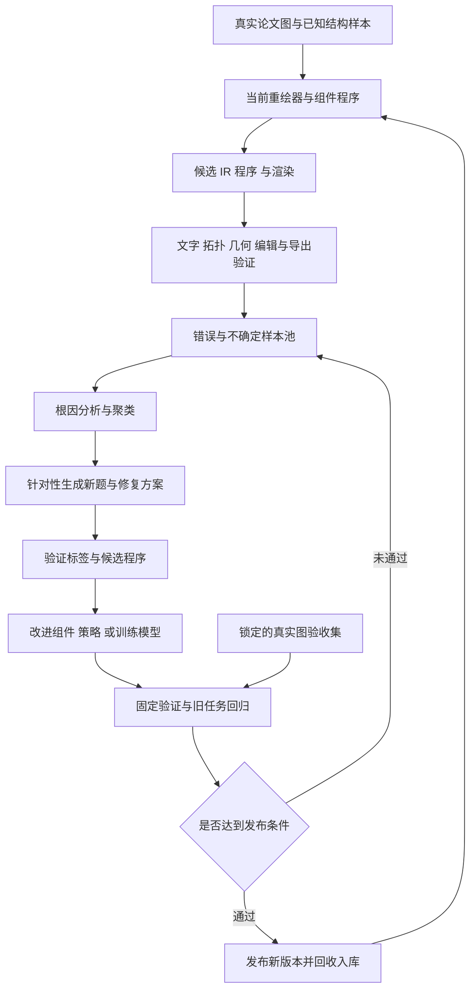

# 科研图矢量化与 RSI 迭代方案

本方案承接 [计算机科研绘图素材库调研](2026-10-28-cs-figure-library.md)，研究怎样让 LLM 辅助的重绘器、组件程序和素材库形成可验证的自我改进闭环。OXR 是用户指定参考；其公开资料与代码检查日期为 2026 年 10 月 28 日。

PDF 与文档解析系统只作参考，不建设 PDF 产品。可定制容器和手绘等样式属于图件核心能力；结构、布局和皮肤分别建模，具体见 [容器与样式方案](2026-10-28-container-styles.md)。

**建议优先实现以已知图结构为反馈的系统级改进，再扩展到模型后训练。** 组件程序能够生成图像及准确的文字、几何和连接标签，是这类任务很有价值的训练与评测来源。真实论文图负责补足复杂结构、真实风格和分布差异。

## 1 OXR 实际提供了什么

### 1.1 文档与流程图中的 RSI

OXR README 将 RSI 放在后训练阶段。公开流程图包含三个部分：预测与分类、归因与训练规划、数据生成。模型进行预测和多次 rollout，通用 VLM 区分正确、错误和不确定样本；预测分歧也用于发现不确定样本。随后逐样本分析原因并聚类，结合真实样本风格生成新的 image 与 label，再训练模型。[OXR README](https://github.com/SoMarkAI/OXR)、[官方 RSI 流程图](https://raw.githubusercontent.com/SoMarkAI/image_bed/main/OXR_README/assets/oxr_rsi_loop.png)。

这是作者公开说明的机制；流程图没有给出足以复现全部数据质量、归因准确率和训练收益的实验细节。本轮没有运行其训练或复现榜单。

### 1.2 所查代码的范围

本轮只读检查了提交 `c1a1dcb312ee9f691404f127785510453c0d9350` 的文件树、README、解析路径与 benchmark 文档。找到的主要是推理服务、布局、识别、阅读顺序、后处理与测试；未在所查文件中找到完整的 RSI 归因聚类、数据生成及模型后训练入口。因此，OXR 适合作为闭环设计参考，不能据此宣称我们已经获得可直接运行的完整 RSI 训练系统。[所查版本](https://github.com/SoMarkAI/OXR/tree/c1a1dcb312ee9f691404f127785510453c0d9350)。

其图片路径也有明确边界：`recognize_block` 对 Picture 走保存裁剪图流程，后处理返回图像引用。它没有在这一路径中把科研图恢复成文字、节点和连接器。[识别路径](https://github.com/SoMarkAI/OXR/blob/c1a1dcb312ee9f691404f127785510453c0d9350/oxr/pipeline/recognition.py)、[图片后处理](https://github.com/SoMarkAI/OXR/blob/c1a1dcb312ee9f691404f127785510453c0d9350/oxr/pipeline/postprocess/picture_postprocess.py)。

OXR 可另作为文档抽取候选，但当前许可证是 Apache-2.0 加附加条款，包括融资或收入门槛、在线服务标识和竞争性托管 API 限制。是否采用其模型与代码，要与借鉴 RSI 方法分开决定。[该提交的 LICENSE](https://github.com/SoMarkAI/OXR/blob/c1a1dcb312ee9f691404f127785510453c0d9350/LICENSE)。

## 2 把 RSI 的改进对象明确下来

| 改进层 | 改什么 | 一轮产生什么 | 怎样确认有改善 |
| --- | --- | --- | --- |
| 单次重绘修正 | 当前图的对象、文字、布局和连接 | 一张更好的图与修正记录 | 当前任务检查通过 |
| 组件程序改进 | 参数、端口、布局、渲染与导出实现 | 新组件版本与回归记录 | 新参数和组合测试通过，旧用例没有退化 |
| 生成系统改进 | 检索、提示、路由、分解与修复策略 | 新的流水线配置或程序 | 独立验证任务中的质量与成本改善 |
| 模型后训练 | 自有或允许训练的重绘模型权重 | 新 checkpoint 与训练数据版本 | 独立重绘、编辑和泛化评测改善 |

单张图的 render 与 critique 循环只解决当前任务。要形成持续改进，应将错误、修复和验证结果积累下来，并升级可复用的组件、策略或模型。每轮升级都要有版本与独立比较。

使用 GPT Image 等 API 时，我们可以改进参考选择、提示、规划、图像重建和入库策略。回收调用结果本身，不应被描述为已经更新供应方的图像模型权重。

## 3 FastFigure 的闭环

有两个反馈方向：一是重绘器学会准确理解图，二是组件生成器更容易产出可读、可组合、可导出的图。二者分别版本化，避免同一轮同时改变题目、答案和评分后，无法判断进步来自哪里。

### 3.1 LLM 辅助矢量化的具体分工

下面是建议的模块划分，尚未实现：

| 环节 | 程序提供的证据或操作 | LLM 负责的判断 | 可检查的产物 |
| --- | --- | --- | --- |
| 输入路由 | 检查图件源文件中的文字、路径、图像和变换 | 判断图件类型、混合区域和分解方式 | 保留原始坐标映射的区域清单 |
| 文字与几何 | OCR、原生文字、线段与轮廓候选、端点和颜色统计 | 消解上下标、遮挡与图元类别歧义 | 带证据区域的文字和图元候选 |
| 结构恢复 | 空间邻接、相交、包含和箭头候选 | 推断模块、端口、分组、边方向与重复结构 | 显式节点与关系图，不确定项单列 |
| 组件匹配 | 检索预览、签名、参数与端口 | 选择组件，拟合参数或提出新组件 | 可追溯的实例与参数 |
| 组装与修复 | 排版、渲染、差异定位和约束检查 | 根据具体错误提出局部 patch | 保持稳定 ID 的 FigureIR 或程序版本 |
| 导出与复核 | 编译、重新读取、执行改字与移动任务 | 解释剩余差异和需人工检查项 | 格式能力与编辑任务报告 |

LLM 通过受约束的工具调用获取局部放大图、查询 OCR、试渲染组件和提交对象 patch。一次修复只改有证据支持的区域，文字、布局和拓扑分别检查；发现箭头歧义时保留候选解释，不用整图重画掩盖问题。

首轮研究的 [generic-pixel-svg-rebuild](https://github.com/neverclover/generic-pixel-svg-rebuild) 可用于理解渲染对照和像素复现。它以像素区域恢复外观的表示，距离可修改的文字、模块和连接关系还有语义恢复步骤；具体静态分析见 [首轮调研](2026-10-28-landscape.md)。对截图或图标局部可以保留栅格或轮廓对象，不必强行推断不存在的组件语义。

### 3.2 每轮保存可复现的改进包

一个改进包应包含失败输入与区域、旧版本、可核验的失败断言、根因假设、修复候选、针对性样本、旧任务回归和独立验证结果。组件实现、重绘策略、模型权重分别填写变更版本。

例如“把标签加长后遮住输出端口”可以变成具体断言：文字边界不与端口保留区相交、标签值完整、输入输出端口数量和边保持不变。LLM 提出换行或扩宽方案，程序生成长标签变体并验证，独立真实图检查其泛化。通过后发布新组件；失败仍保留原版和错误记录。

## 4 为矢量化建立可核验的答案

### 4.1 从程序生成已知答案

从经过检查的组件程序和 FigureIR 生成矢量图，再渲染成输入图像。程序同时输出文字、几何、层级、端口、边和参数。由此得到输入图像与目标结构的对应，不必让另一个模型猜全部标签。

生成器可以系统改变：组件数量、分支与反馈、标签长度、字体、间距、颜色、线型、端口位置、图像分辨率、压缩和轻微页面变换。空间变化要同步作用于目标坐标，不能只改变输入而留下错误 bbox。

再将同一结构渲染为规范、标题带、虚线和手绘等皮肤，节点、边、文字和端口标签保持一致。用这些样本检查排线、双笔触和开放边框是否被误识别；真实图则检验样式泛化。

强退化可能使小字或细线变得不可辨识。这类样本标注为有歧义或超出支持范围，不把要求模型猜出不可见细节的题目当成高质量训练数据。

### 4.2 真实图使用分级标签

| 来源 | 可以确认什么 | 标签级别建议 |
| --- | --- | --- |
| 原作者程序或可编辑源 | 程序渲染与结构，经检查后可追溯 | 强标签候选 |
| 人工逐项校对的真实图 | 已核验的文字、边、层级与局部几何 | 强标签，注明校对范围 |
| 通用 VLM 重建的真实图 | 一个候选解释 | 弱标签，需要验证与抽查 |
| 模型间分歧 | 可能存在错误或歧义 | 不确定样本，不能直接作为正确答案 |
| 用户局部修改 | 某项修改意图与前后差异 | 该局部的监督信号 |

VFIG 的数据设计同时使用真实复杂图与程序形状箭头，并通过结构和视觉反馈评估输出，说明两类数据可以互补。我们仍需按自己的图件和编辑任务验证。[VFIG 数据与方法](https://arxiv.org/html/2603.24575v1)、[规则评测说明](https://github.com/RAIVNLab/VFig/blob/main/rule-based-eval/README.md)。

### 4.3 GPT Image 样本如何形成可靠训练对

GPT Image 可以根据内容规格和参考图探索视觉风格，也可以提供难例候选。其生成图中的文字、几何和拓扑必须重新检查。

尤其是，将程序渲染图交给图像模型换风格后，不能直接假定原来的所有标签仍然正确。图像模型可能改变节点、文字或连线。应验证变换后的对应关系，必要时重新标注。

一条更容易控制的回收路径是：生成图 → 候选结构 → 文字与拓扑校验 → 校正后的组件程序 → 重新渲染 → 形成已知结构的训练对。原始生成图与程序渲染图分别保存，避免把后者准确性推广到前者。

## 5 错误分类和归因

| 错误族 | 例子 | 优先改进的对象 |
| --- | --- | --- |
| 文字 | 丢字、希腊字母或上下标错误、重复标签 | OCR、文字恢复、排版与字体测量 |
| 基础几何 | 框线缺失、端点偏移、曲线和裁剪错误 | 图元解析与几何编译 |
| 拓扑 | 箭头反向、误连、漏边、交叉线误当连接 | 关系恢复、端口与连线策略 |
| 层级 | 子图归属错、跨容器连接重复 | 分组识别、模块边界与父层连接规则 |
| 重复结构 | 多个 block 数量错、内容不一致 | 重复模式识别与参数化生成 |
| 参数变化 | 改长标签后溢出、增分支后重叠 | 组件参数契约和布局程序 |
| 样式与容器 | 排线误当边、双笔触重复识别、换风格后端口或语义颜色丢失 | 逻辑/装饰几何分离、样式约束、保护区与种子策略 |
| 格式导出 | 原生文字变路径、连接器绑定丢失 | SVG/PPTX/draw.io 编译器 |
| 科学含义 | 训练与推理混淆、控制流画成数据流 | 当前论文内容规格与语义核对 |

LLM 可以提出根因与修复假设，但归因应附带证据，例如哪个标签不符、哪个端口误连、哪个参数组合失败。把“看起来不好”转成可复现错误任务，才能生成有针对性的后续数据。

高分歧是挑选检查对象的信号，不是正确与错误的最终判据。优先选择影响科学含义、覆盖新结构、重复出现且修复成本高的错误。

## 6 组件程序怎样迭代

建议把组件定义为带语义与约束的可执行资产，而不只是一个无接口的 SVG 字符串。最小契约包含输入参数、命名端口、尺寸与文字边界、内部关系、样式令牌和支持格式。

以双分支融合组件为例，参数可以控制分支标签、每个分支的模块数、融合方式、阅读方向和整体尺寸；外部端口明确对应两路输入和融合输出。生成器负责内部几何，父布局负责组件间连接。

LLM 可以提出下列改进：补充标签换行策略，给分支增加稳定 ID，调整端口分布，把固定模块数泛化为参数，或从两个组件提炼更通用的子程序。候选版本必须进入测试后才能替换正式版本。

### 6.1 参数和变换测试

| 变化 | 应保持或满足的性质 |
| --- | --- |
| 改标签 | 文本值正确，不能漏字或遮挡；允许按规则重新布局 |
| 改配色 | 拓扑、标签和端口不变 |
| 切换容器皮肤 | 结构和语义编码保持，装饰不遮挡文字或端口，相同参数与版本可复现 |
| 缩放 | 归一化几何与拓扑一致，最终文字仍满足目标尺寸约束 |
| 改组件数量 | 数量与参数相符，新对象 ID 唯一，连接完整 |
| 改阅读方向 | 语义边方向不变，路由按布局调整 |
| 与其他组件组合 | 无 ID 冲突，边界端口明确，父子坐标正确 |
| 改导出格式 | 支持对象的文字与连接仍可修改；降级项可识别 |

这些测试可以提供部分无需模型主观打分的反馈。它们证明的是契约性质，不能单独证明整张图的科学结论正确。

## 7 重绘器怎样迭代

第一阶段可以改进结构化提示、分块、检索与修复程序。每个失败样本记录输入、目标结构、候选结构、失败类别、修复结果、模型与组件版本，并保留失败尝试。

在后训练阶段，优先考虑三类数据：程序生成的强标签图像到 IR/代码，核验过的真实图重建，以及有明确修改目标的前后编辑对。VFIG 可作为专用模型与评测基线，DeTikZify 可作为图像到程序的另一路线。[VFIG 代码](https://github.com/RAIVNLab/VFig)、[DeTikZify](https://github.com/potamides/DeTikZify)。

开始时用 SFT 检查是否能提高结构恢复和程序可执行率；在标签和评分稳定后，再比较偏好学习或基于验证器的强化学习。模型大小、GPU、训练参数和调用成本应由试验测量决定，不从另一种文档解析模型的参数量推算。

程序执行和解析在固定环境中完成，限制依赖、文件与网络能力。生产导出器、评价器和发布门槛由工程代码管理，生成模型只能提出候选，避免它通过改评分规则提高自己的成绩。

## 8 评分与版本晋升

### 8.1 将必须正确的项目设为门槛

程序可执行、文件可打开、关键文字正确、要求的连接关系完整、支持的端口绑定有效，是支持范围内的硬性条件。可以在通过后比较几何、视觉、复杂度、成本和修改时间。

不建议把所有维度简单相加：漂亮的配色不能抵消关键箭头错误，低像素误差也不能证明文字仍可编辑。对含照片、截图的混合图，保留图像素材可以是正确表示。

### 8.2 将回归与泛化分开

| 集合 | 用途 | 是否进入迭代生成 |
| --- | --- | --- |
| 错误开发集 | 归因、修复、生成新题 | 可以 |
| 旧能力回放集 | 防止修复一种图后破坏其他组件 | 可以用于研发，但与最终验收分开 |
| 固定验证集 | 比较候选版本与当前版本 | 不将具体答案或失败内容自动回流 |
| 锁定验收集 | 阶段性发布判断 | 不用于调参、参考检索或训练 |
| 新论文与新结构集 | 检查真实分布泛化 | 先评价，再在后续数据版本中明确其角色 |

同一论文不同版本、原图与重绘、从同一模板生成的变体保留谱系分组，避免仅换颜色或改字体就跨越训练与验收。

### 8.3 晋升需要可归因的收益

一轮记录具体改进对象、预算和版本差异。候选通过目标错误族验证后，还要跑旧能力回归和独立验证。只有支持范围内的硬条件通过、关键能力无明显退化，并在质量、成本或人工修改时间上有实际收益，才发布新版本；否则保留证据并回滚候选。

“素材数增加”“模型自评分变高”“循环跑了更多次”都不足以单独证明系统变强。应报告独立任务上的成功率、拓扑与文字错误、参数测试通过率、重开与修改成功率，以及达到可用状态的总成本。

## 9 第一轮 RSI 实验

以下是建议实验规模，不代表已有数据或效果：

1. 从计算机图件中选择 12 类常见组件，人工确认最小程序、端口和样式契约。
2. 每类先生成 40 个可验证实例，得到 480 个结构已知样本；覆盖参数和布局变化，保留生成器家族划分。
3. 加入 50 张真实图或局部子图作适配检查，真实图与合成图分别报告。
4. 固定当前重绘器，收集首轮错误并分到文字、拓扑、几何、层级与参数变化等类别。
5. 针对高频错误生成新题和组件修复候选，先进行两轮系统级改进。
6. 在固定预算和独立验证下比较零轮、一轮、两轮结果；若收益存在，再扩大数据和研究模型后训练。

可优先选择的 12 类为：通用模块、encoder/decoder、token 序列、矩阵/张量、双分支融合、多尺度结构、反馈回路、缓存与队列、存储层次、查询算子树、协议时序、信任边界。

对照至少包含：只积累参考图、增加参数化组件、增加错误归因与针对性数据、再增加模型训练。这样能分清收益来自素材、程序、策略还是权重。

## 10 研发结论

用户提出的 LLM 辅助矢量化和 RSI 可以成为同一套架构：真实论文图带来设计与难例，组件程序把经验变成可调用工具，并生成结构已知的数据；重绘器在这些数据和校正案例上改进；新版本经独立验证后用于下一轮采集、生成与重建。

第一阶段最值得建设的是组件契约、可靠标签、失败归因和版本评价。它们既支持程序级自我改进，也为后续模型训练提供可用数据，能够避免把持续生成结果误当成持续提高能力。
