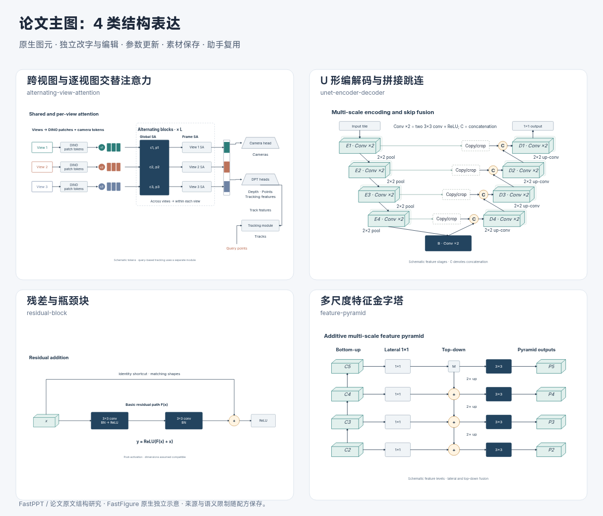
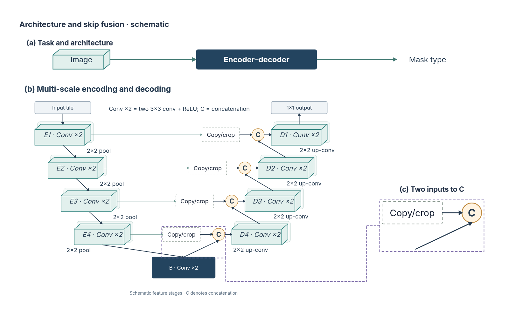
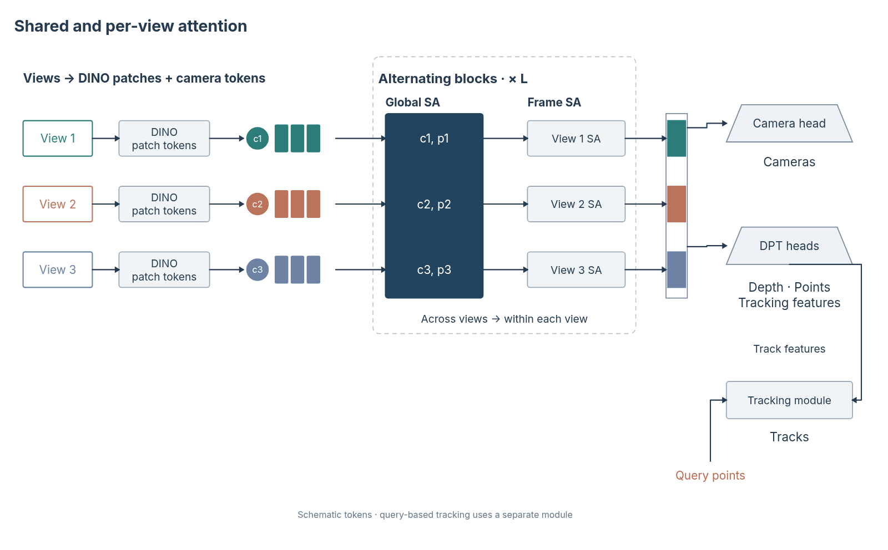

# 旧结构的视觉改造：多尺度、跳连与共享注意力

2026-10-31，第九十三批。延续用户“结构都做到了，但是还是很丑”的反馈，这轮改造四种已有配方，没有继续增加结构数量。目标是让对象轮廓、主次和编排承担解释任务，同时保留科学关系、原生编辑和可追溯的局部对应。

## 四种已有结构的变化

| 配方 | 视觉变化 | 保留的科学关系 |
| --- | --- | --- |
| U 形编解码 | 用特征体表现阶段表示，收紧横纵间距；拼接点用紧凑符号，复制／裁剪用轻量框；主图提高主体比例和文字大小 | copy/crop 后 C 拼接，两个不同输入；2×2 pool、2×2 up-conv、共享瓶颈及 1×1 输出 |
| 残差／瓶颈 | 输入表示、卷积主路径、投影捷径、加法与激活形成不同视觉角色；减少重复长标题 | 主路径最终卷积后先加捷径再 ReLU；恒等与投影的含义不变 |
| FPN | C/P 特征体、横向投影、圆形相加和输出卷积分工；保留对齐的多尺度行 | bottom-up、1×1 lateral、top-down 2× up、加法和输出 3×3，未改成 U-Net 拼接 |
| 跨／逐视图交替注意力 | 相机标记与 patch 条带区分；跨视图共享块是深色主视觉，逐视图块与辅助模型较轻；不同视图保持颜色身份 | 全局联合自注意力与逐视图独立自注意力交替；相机／图像 token 消费者不同；跟踪仍需查询点和额外模块 |



图形轮廓是表示和操作的示意，不是实际特征尺寸或网络内部重建。每行三个 patch 色条只说明一组图像位置，不等于真实 token 数。

## U 形主图：先紧凑组织，再安排缩放

[改造前图](assets/unet-mainfigure-before-visual.png) 保留用于比较。此前完整结构横向铺得过宽，组合时整体缩小，造成主体文字偏小；任务概览又占用了较多高度。

这次保留五个示意尺度，缩小配方内部的水平和垂直空隙，压缩概览高度，给完整机制更多版面。源图说明宽度重新限定在输入／输出之间，避免收紧布局后说明盖住输出。主区采用更大绘制比例，阶段文字也放大；没有靠删除尺度或改变拼接方式简化关系。



[原生工程](assets/unet-mainfigure-before-review.json) · [SVG](assets/unet-mainfigure-before-review.svg)

右侧仅放大实际选中的 `crop-3`、`concat-3`、`crop-concat-3` 和 `up-3`。它解释两路输入如何进入 C，不再复制整个瓶颈、解码阶段和重复说明。上卷积路径来自真实源图，快照保留其几何并解除未选瓶颈端点的绑定；原图中的对应关系保留。来源记录保留实际请求 ID、1.6 倍比例和一个解除绑定端点。

对应引线按实际空白通道整理为一条无箭头折线，并核对其不穿过未选对象。标题只保留简短语义，倍率、快照类型等留在来源记录。此为原生图元编辑的开发样例，不宣称通用快照工具已经具备自动最优编排或避障。

本节固定保留第九十三批样例。当前构建器已经按第九十五批的[实际审阅修改](2026-10-31-mainfigure-revision.md)生成新的融合解释图。

## 共享注意力：保留有意义的边界

[改造前图](assets/multiview-mainfigure-before-visual.png) 的输入、token、注意力和输出头几乎都是同样的框。调整后，读者可先看到跨视图共享机制，再追踪各行身份和分型输出。



[原生工程](assets/multiview-mainfigure.json) · [SVG](assets/multiview-mainfigure.svg)

“减少大框”不是删除所有边界。重复 L 次的范围有实际含义，因此保留透明虚线框；辅助模型不用与主体同等深重。复用的呈现函数新增显式保留边界选项和辅助模型角色，规划与绘制提示补充“先整理间距、避免整图缩字”的规则。

渲染时发现自由组合的显式 `visual.dash` 虽能保存，但精确 SVG 外框未显示该设置，现已修复。检查直接读取生成的 SVG 外框属性，避免只依据元数据声称虚线生效。手绘外框不在本次修复范围内。

## 验证与未完成项

复用原有资产场景，补充有实际风险的断言：紧凑布局说明不盖住输出；重复框的虚线进入实际 SVG；新增相机标记改字后在视图数调整中保留。原有路径端点、拼接／相加语义、SVG 元数据和参数更新检查继续运行，没有锁定整张图的颜色或以节点数量打审美分。

606 项核心／服务检查、40 个文件，Lint、类型、生产构建和原四条 1920×1080 UI 流程通过。另核对四类八组代表参数、两张实际组合图的浏览器字形，以及实际引线通道；所有二十八种默认资产可构建。没有新增 UI 流程或真实模型调用。

测试和字形检查不证明论文成图已经达到最优审美。当前仅将这四种旧配方的视觉词汇、版面和实际示例向前推进，其余结构和真实模型的稳定编排仍需继续审阅。来源关系继续沿用已有[近期主图研究](2026-10-31-recent-mainfigures.md)、[跳连研究](2026-10-31-skip-composition.md)与[证据清单](paper-structure-evidence.json)。

```bash
node --experimental-strip-types scripts/build-composite-example.mjs --example=unet
node --experimental-strip-types scripts/build-composite-example.mjs --example=multiview
node --experimental-strip-types scripts/build-structural-overview.mjs --ids=unet-encoder-decoder,residual-block,feature-pyramid,alternating-view-attention --output=architecture-visual-overview.svg
```
