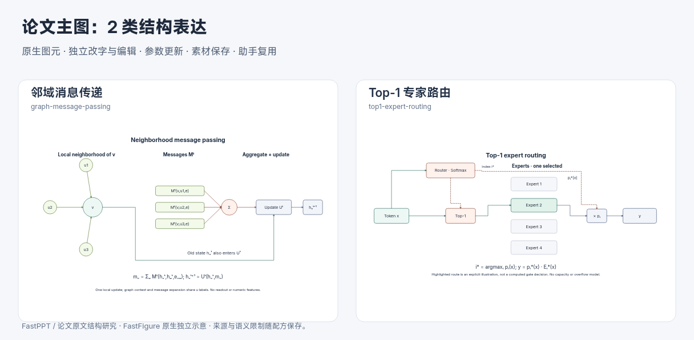
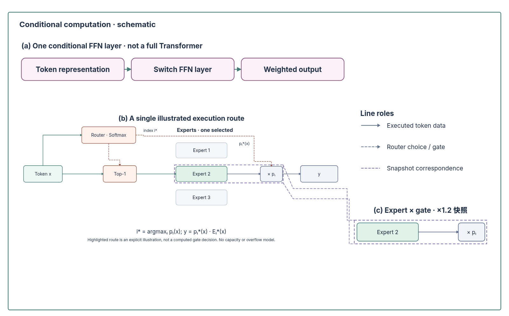

# 图聚合、条件路由与主图的关系层次

2026-10-31，第八十八批。继续从原始 PPT 的经典结构与原论文中提取有内容依据的图形。本轮增加局部图消息传递和单 token 条件路由，结构配方共十六类，全部参数化组合二十二种。

## 原文依据与语义区别

| 原文 | 本轮抽象 | 明确的边界 |
| --- | --- | --- |
| [Neural Message Passing for Quantum Chemistry](https://proceedings.mlr.press/v70/gilmer17a.html)，§2、Eq. 1–2 | 一个目标节点的局部邻域，与逐邻居消息、求和聚合、结合旧状态的更新展开对应。图和分支的 u 标签顺序一致。 | 依据原文公式独立构造，不是原文 Figure 1 的分子任务图描摹。只说明一次局部更新，不含全图读出、注意力、真实边特征或分子几何；消息箭头不表示原图拓扑一定有向。 |
| [Switch Transformers](https://www.jmlr.org/papers/v23/21-0998.html)，Fig. 2、§2.1 | 一个 token 进入路由器，仅为显式选中专家生成数据路径，专家输出再乘门控值；路由选择和门控值有各自的虚线。 | 高亮是参数指定的示意，不执行真实 argmax，不给概率数字。未执行专家保留为独立候选卡片；不含容量、溢出、辅助损失或完整 Transformer。 |

[证据清单](paper-structure-evidence.json) 保存原文地址、核对页码和 PDF 指纹。应用不依赖这些 PDF，未打包论文原图或观测数据。



局部图、并行消息展开、扇入聚合与状态旁路共同解释一次更新。专家路由则需要候选银行、单条执行路径和独立门控；把所有专家画成同时运行，会改变含义。相似的扇入／分支外形不能代替这些内容区别。

## 接入方式

- `graph-message-passing`：`neighbors=2..5`。节点、邻居箭头、消息函数、Σ、U、下一状态及旧状态旁路分别可编辑；邻居数只控制图示，不是实测图规模。
- `top1-expert-routing`：`experts=2..5`，`activeExpert=1..experts`。编号为一基，别名 `expert-i` 为零基。只选中专家拥有执行路径，超过数量明确拒绝，不自动换一个专家。候选、选中路径、控制／权重和输出分别可改。

目录继续携带结构族、叙事角色和误用边界。手工文字、有效外部引用、来源与元数据保留，参数更新、素材采集和 SVG 往返沿用现有机制。

## 组合示例与一致图例



[可编辑工程](assets/routing-mainfigure.json) 可从“工程 → 导入”打开。左上概览交代一个条件 FFN 层的范围，主区展开路由与候选专家，右侧统一线型图例并放大实际选中的“专家输出 × 门控”片段。这里结构、线型和局部内容围绕同一解释目标，未添加不相关分支或模型组件。

源框内片段由实际原生对象复制；不是像素裁片或同步视窗。对应引线在示例里用已有路径编辑整理为折线，绕开原始图元；这不是通用自动避障能力。图例以中性色展示线型，主图颜色仍区分选中专家与未执行候选。

```bash
node --experimental-strip-types scripts/build-composite-example.mjs --example=routing
```

示例为程序构造的开发案例，没有实验结果，不是实际模型规划质量评测。

## 把规划约束落实到入口

检查发现：旧入口为了兼容历史方案，仍接受缺少 `design` 的新 ready 结果。现在新规划默认必须给出每区的结构理由、主次和归一化版面，缺失时整次失败。已有的分区位置／归属与有向连接／局部对应检查继续生效。信息不足的 needs-input 可以先问清含义，不需要编造版面；历史工程记录仍可读取。

原 CLI 夹具和桌面规划流程已改为生成实际分区框与实例归属，并在服务场景验证缺少设计不能生成可采用报告。模型不能通过 JSON 改写低层兼容策略。

## 验证与下一步

旧二十种默认资产逐项保持。599 项核心／服务检查、40 个文件通过；Lint、类型和构建通过。四条 1920×1080 UI 流程通过，本机实测 53.54 秒，没有增加 UI 流程或适配器矩阵。

新风险检查覆盖邻居与消息／旧状态对应、仅一条专家执行路径与独立门控／非法编号、严格新方案与历史／待补充边界。另检查四组最小／最大配置及实际组合图的浏览器字形；示例文本估算无省略，对应引线未穿过未选原始图元，最终渲染人工核对。

多阶段训练／推理、分层路由、异构图和真实模型的组合质量验证继续迭代。
