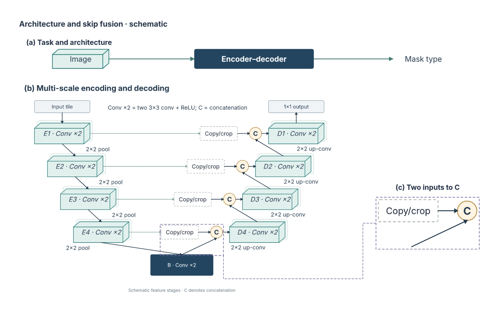

# 从结构正确到主图设计：一次实际成图审阅

2026-10-31，第九十四批。回应“结构都做到了，但是还是很丑”，本轮没有继续增加配方数量；补上普通主图的成图审阅入口，并用已经改过视觉的 U-Net 主图进行一次真实模型调用。

## 原因与能力缺口

局部拓扑、图元可编辑和文字不溢出只是基础。所有模块视觉重量相近时，读者看不出论点；概览比机制更醒目时，读者会先看到通用流程；放大图没有交代来源时，结构组合仍然割裂；引线虽不穿过对象，也可能让读图路径绕行。结构组合需要视觉主次、图形词汇、密度与跨区域对应一起设计。

此前已有规划和绘制提示、语义图形呈现、几何与真实字形检查，但普通主图缺少针对实际成品的独立设计报告。双图审阅主要服务参考图重建保真度，不能把“接近原图”直接等同于“设计清楚”。

## 接入系统

助手新增“审阅当前主图”，发送整图实际渲染和用户关注，在独立会话中返回第一眼重点、阅读路径、值得保留的表达，以及分别说明观察、影响和建议的报告。点击标题定位受审图片区域，可选中相关原生对象；画布改变后保留历史并提示重审。本轮不生成图件或自动修复。

沿用已有 Harness 运行、图片回看和历史接口。严格报告契约与几何别名阻止模型注入图件、补丁或虚构对象；快照和图片字节固定版本。详见[使用与边界](../development/design-review.md)。

## 一次真实调用

通过已有 `experiments/visual-audit-live.mjs --design-review` 入口，对[可编辑 U-Net 主图](assets/unet-mainfigure-before-review.json)进行一次调用；Codex CLI 0.165.0，CLI 默认模型，实际输入为 1600×992。没有调用额外生成或修复。模型具体版本未由本次记录确认。

模型保留了 U 形主干、逐层跳连、不同轮廓和真实局部对应；指出三条设计意见：

| 观察 | 对阅读的影响 | 建议方向 |
| --- | --- | --- |
| 顶部深色 Encoder–decoder 框比主体跳连更抢眼 | 第一眼看到通用流程，后找核心机制 | 减轻概览，将重点给予一组代表性跳连 |
| 局部图下路仅有输入箭头，没有来源名称 | 独立阅读无法直接判断对应的上采样路径 | 核对模型后补充简短来源标注 |
| 来源框贴近瓶颈，紫色引线向下绕行再向上 | 与主干路径挤在一起，增加追踪负担 | 调整来源框与局部位置、缩短引线 |

对照实际图片，上述位置可见，意见具有可讨论的依据。第九十四批尚未应用这些意见；本节保留的是当时受审版本，不能把新增报告视为已经改善视觉。完整[模型报告与图片指纹](assets/unet-design-review-live.json)保留，运行事件和提示位于本机 `test-results/mainfigure-design-review-live/`。

模型也明确缺少刊印尺寸，不能据屏幕缩览保证论文栏宽下的小字可读；没有推断裁剪规则与上采样具体实现。这是一次执行证据，不是盲评、审美评分或对全部配方的质量结论。

## 检查范围

609 项、40 个核心／服务文件覆盖既有功能和本轮报告契约、图片身份、隔离执行及只读定位；桌面仍沿用原四条 1920×1080 流程。本轮没有新增逐结构 CLI 矩阵或 UI 流程。构建保留既有包体与扩展名提示。

下一步根据研究论点落实具体视觉调整，再看实际成图；继续改造尚未处理的结构，并检查完整主图的视觉优先级和跨区域对应。

第九十五批已落实三项具体修改并保留新一轮审阅，见[从审阅到实际修改](2026-10-31-mainfigure-revision.md)。
