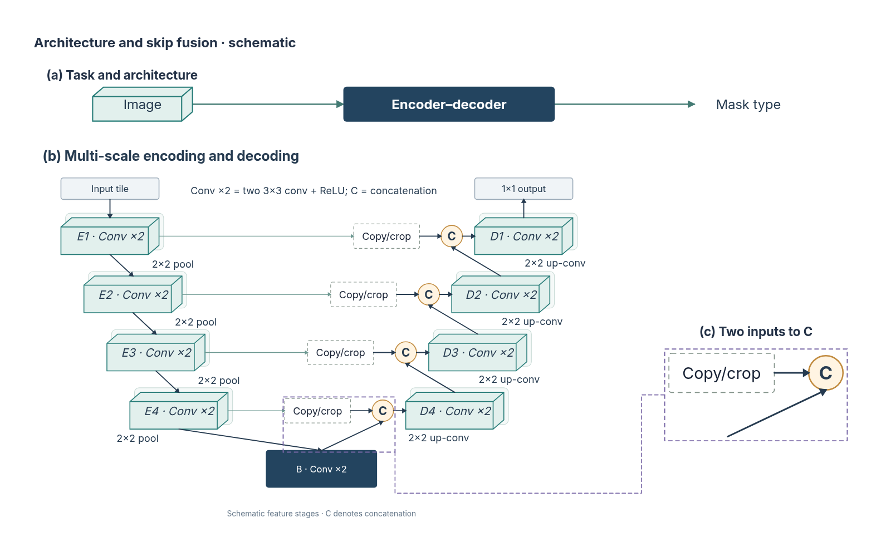
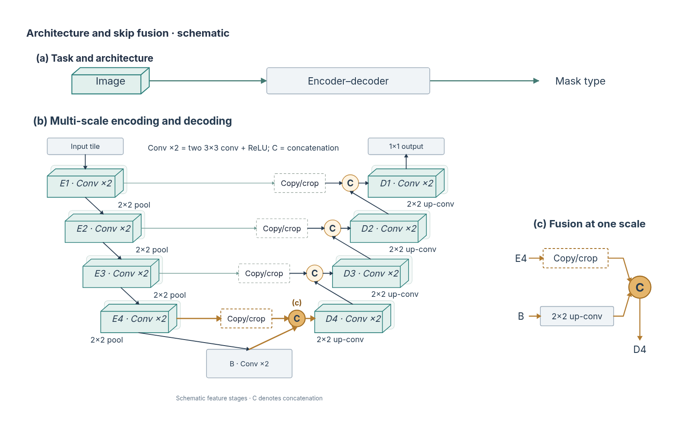

# 把主图审阅落实到实际编排

2026-10-31，第九十五批。针对上轮真实审阅中的三个问题，修改现有 U-Net 复合主图，没有增加结构种类或更改主架构拓扑。

## 实际变化

| 问题 | 本轮修改 | 保留的含义 |
| --- | --- | --- |
| 通用概览比核心机制更醒目 | 概览和瓶颈改为轻量呈现，最深尺度的代表性双输入和 C 用暖色突出 | 仍是同一 U 形主干，各尺度仍然可比较；颜色不表示计算权重 |
| 局部图第二路输入没有来源 | 右侧明确写出 E4 → Copy/crop、B → 2×2 up-conv，二者进入 C 后到 D4 | 输入、操作与目的阶段均取自已有最深尺度分支；C 是拼接，未改成相加 |
| 真实放大框贴近瓶颈，长引线绕行 | 用单尺度的概念性解释替代该处实际快照，(c) 与同名阶段建立对应，删除两处放大框和跨区引线 | 右图重新组织已有关系，不是逐对象放大；元数据与方案均明确这一点，不新增跨区数据流 |

修改前，固定保留当时受审版本：



修改后：



[当前可编辑工程](assets/unet-mainfigure.json) · [固定修改后版本](assets/unet-mainfigure-after-review.json) · [SVG](assets/unet-mainfigure.svg)

原主架构的所有配方对象保持文字、几何、结构和路径绑定；本轮只改变其部分视觉外观，另建原生解释区。右区的五条路径有端点绑定，按原主图核对阶段身份及上卷积名称，并检查不穿过其他节点。没有添加图像、观测值、尺寸或实验结论。

## 进入助手的选择依据

规划、普通绘制和成图审阅共用的设计规则补充：围绕研究论点选择重点，概览中的模型不能仅因是模型就使用最重的深色；重复结构可以只强调一个有代表性的分支，其余维持比较关系。

局部说明应先选择形式。需要逐对象对照时用真实选区快照；需要独立解释输入、操作和输出时可重排为示意图，并用同名阶段、符号与标记说明对应。对应关系不必都画成长引线，也不能把重新绘制的内容说成真实放大。方案中的 `detail` 继续要求无箭头绑定引线；无需引线的概念对应使用 `membership` 并说明关系。这是生成能力的设计依据，尚未证明模型能稳定执行所有新规则。

真实快照工具和其他实际快照示例继续保留；本图选择其他说明形式，不改变其复制、来源和参数更新能力。

## 复审及一次实际失败

本轮使用已有显式实验入口，对修改后整图运行两次独立真实调用。第一次返回五项 keep，超出严格报告的四项上限，因此被拒绝，未接受其结论。发现提示未明确这项上限后，补齐 keep、uncertainties、各字段与对象列表的预算；核心场景继续检查超限拒绝，没有裁掉多余项假装成功。实验入口同时补充失败时保留实际发送图片。

[被拒原响应](assets/unet-design-review-rejected.json)保留。修改约束提示后第二次成功；两次工程和图片指纹相同。CLI 为 Codex 0.165.0、默认模型，模型具体版本未由记录确认；本轮没有额外的生成或自动修复调用。

有效复审认为：代表性金色分支形成重点，浅色概览不再争夺注意，右侧两路输入与原阶段对应明确。仍提出两项次要意见：底部 pool／up-conv 标注距离所属线路偏远；C 的定义在顶部说明和脚注重复。这两项仍待后续整理，不将报告项数变化当作审美验收。

[有效报告与图片指纹](assets/unet-design-review-after.json) · [实际受审图片](assets/unet-design-review-after-input.webp)

这不是控制变量盲评：不同轮次使用独立会话，设计提示也有变化。模型意见只能作为进一步检查的线索；刊印尺寸下的可读性仍未验证。

## 检查

- 构建器通过完整方案、实际分区及原生工程校验，文字估算没有省略；新 SVG 经浏览器实际字形边界核对并人工查看。
- 核对历史工程指纹、主架构原对象的内容／几何／绑定保持，局部解释与真实源分支一致，新路径没有穿过其他节点。[几何／语义与渲染检查记录](assets/unet-design-revision-check.json)保留；原始检查位于本机 `test-results/architecture-presentation/`。
- 609 项、40 个核心／服务文件通过；报告上限与方案提示调整后重跑相关四个文件共 67 项，Lint、类型和构建通过。原四条 1920×1080 桌面流程通过，本机实测 57.687 秒；没有新增测试文件、流程或审美评分。

重新构建当前原生样例：

```bash
node scripts/build-composite-example.mjs --example=unet
```

构建器在独立临时素材目录运行，关闭文件监听，避免写入过程中热重启影响样例生成。后续仍需整理主图操作标注，并把相同的视觉取舍逐步落实到其他结构与实际生成结果。
