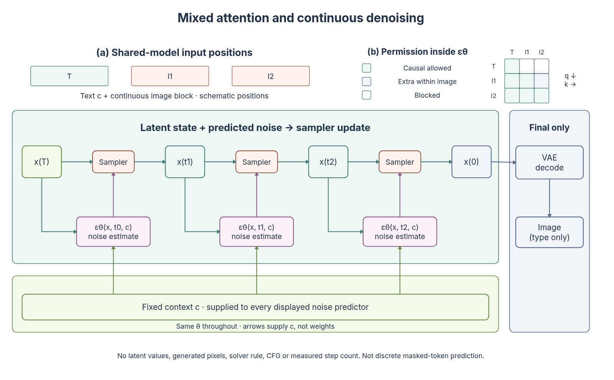
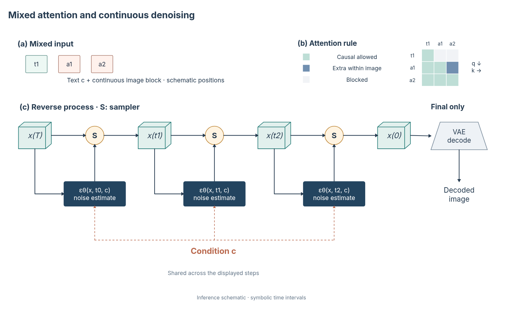

# 多模态主图与视觉设计补课

2026-10-31，第九十一／九十二批。延续近期已录用论文研究，同时根据用户“结构都做到了，但是还是很丑”的反馈，转向图形语言、视觉主次和版面审阅。新增结构是材料，结构数量不作为视觉质量指标。

## 实际查看的原图

| 录用来源 | 查看内容 | 可迁移的关系 |
| --- | --- | --- |
| [Transfusion · ICLR 2025](https://proceedings.iclr.cc/paper_files/paper/2025/hash/12678c3948153f4bc391f51e2082bd6e-Abstract-Conference.html) | Fig. 1、3、4；PDF 2、4 页与 §2.2／§3 | 保持模态身份的输入／输出位置、共享模型带、不同模态的建模目标，以及同一图像内部可双向读取的权限矩阵 |
| [Show-o · ICLR 2025](https://proceedings.iclr.cc/paper_files/paper/2025/hash/45f0d179ef7e10eb7366550cd4e574ae-Abstract-Conference.html) | Fig. 1–5；PDF 2、4、5 页与 §3.2 文本 | 同一模型承接不同任务列；条带、任务对照、注意力矩阵和结果展示互相补充；混合序列随任务改变 |

正式录用来源、实际查看页及 PDF SHA 见 [evidence](paper-structure-evidence.json)。两篇都发表于 ICLR 2025，不以 2024 预印本年份代替录用年份。

## 原生结构及边界

`mixed-modal-mask` 将同一身份的位置条带与 query/key 矩阵对应。支持文本／图像、图像／文本、交错两段和纯文本，文本位置每段 1–3 个、图像位置每段 2–3 个。行是 query、列是 key；允许自身与先前位置，同一图像块额外允许读取后面位置。不同图像块之间不会凭空变成双向读取。色块表示许可，不是注意力观测值；短别名只是图示位置，不是真实词表 ID、序列长度或图像值。省略任务与边界标记 token，不混同连续图像向量与离散图像 token。

`conditioned-denoising` 展开连续潜变量推理：当前状态同时供给噪声预测器与采样器，预测噪声另送采样器，得到下一状态；固定条件 c 供各个共享 θ 的预测器使用；仅最终状态到 VAE 解码。2–4 个显示区间不等同于真实求解器步数。没有模拟潜变量、采样方程、CFG 或图像，也不将其说成 Show-o 的离散掩码替换。

两类都进入目录、参数调整、原生采集与 SVG 元数据链路。当前二十二类结构、二十八种组合。新增主图策略将位置条带、主体机制与矩阵解释结合，明确矩阵解释模型内部限制，不是矩阵给模型输入数据。

## 为什么前版仍然难看

前版主要验收拓扑、原生可编辑、分区与字形边界。它们没有检验图的第一眼重点、对象轮廓是否有语义、文字是否替代了图形，以及大框／底色是否造成视觉噪声。大部分对象共用圆角矩形，浅色分区覆盖全图，标题与长句反复解释同一内容。结构名称增加了，视觉词汇和整体编辑没有同步增加。



本次增加可复用的 `scientificPresentation.ts`：潜变量采用张量体、模型采用少量深色模块、操作使用紧凑圆形符号、解码采用收放轮廓；不虚构模型内部。去掉无需表达真实边界的大底色框，以对齐和空白分区。条件通过同色虚线汇接，文字集中在短图例与图注；矩阵许可使用清楚的类别对比，长别名压缩为一致的位置符号。



[原生 JSON](assets/generative-mainfigure.json) · [SVG](assets/generative-mainfigure.svg)

这张自由图元组合由位置概览、概念性许可矩阵、连续采样主机制、条件汇接和最终解码组成。矩阵不是“真实选区快照”，没有冒称实际注意力值。整张手工编排不作为一个原子参数配方；原生对象、来源与分区方案保留，可逐项编辑。

## 系统接入和验收边界

视觉设计原则同时进入规划提示和实际绘制上下文 `materials.figureDesign`，要求明确核心视觉、对象轮廓、同义颜色、短标注和无需外框的区域。两种新结构已应用同一呈现函数。其余原有结构尚需逐类改造，没有将本轮局部改善宣称为整库审美完成。

保留旧版图用于比较。新增结构的两项语义风险检查覆盖四类权限、跨图像块约束、固定条件、独立采样器与最终解码；另核对边界配置和实际组合图的浏览器字形。连接在创建时解析实际绑定位置，避免零宽垂线的浮点差异造成 SVG 元数据重读不一致。

606 项核心／服务检查、Lint、类型、生产构建和四条 1920×1080 UI 流程通过。构建和字形通过只证明对应工程条件。视觉质量仍需要按论文尺寸审阅实际渲染，并继续比较参考图的表达密度和重点。现有独立视觉审阅主要处理参考图重建保真，不能据此声称已有通用审美评价器；真实模型是否稳定遵循新设计原则也尚未评测。

```bash
node --experimental-strip-types scripts/build-composite-example.mjs --example=generative
node --experimental-strip-types scripts/build-structural-overview.mjs --ids=mixed-modal-mask,conditioned-denoising --output=generative-structures-overview.svg
```
