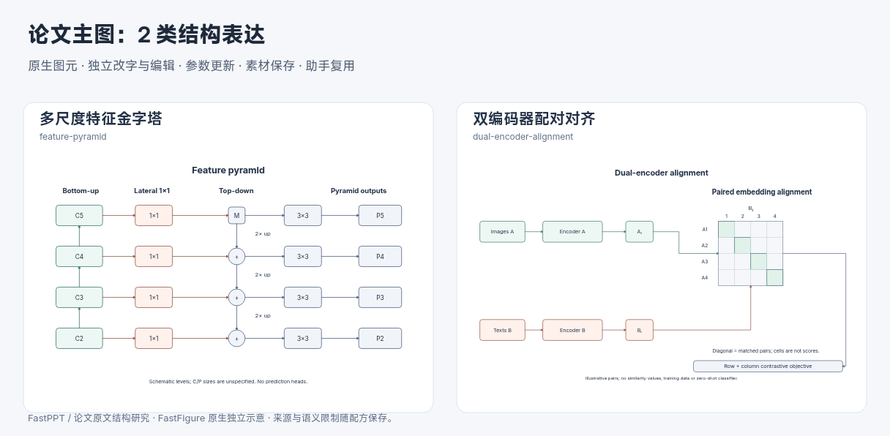
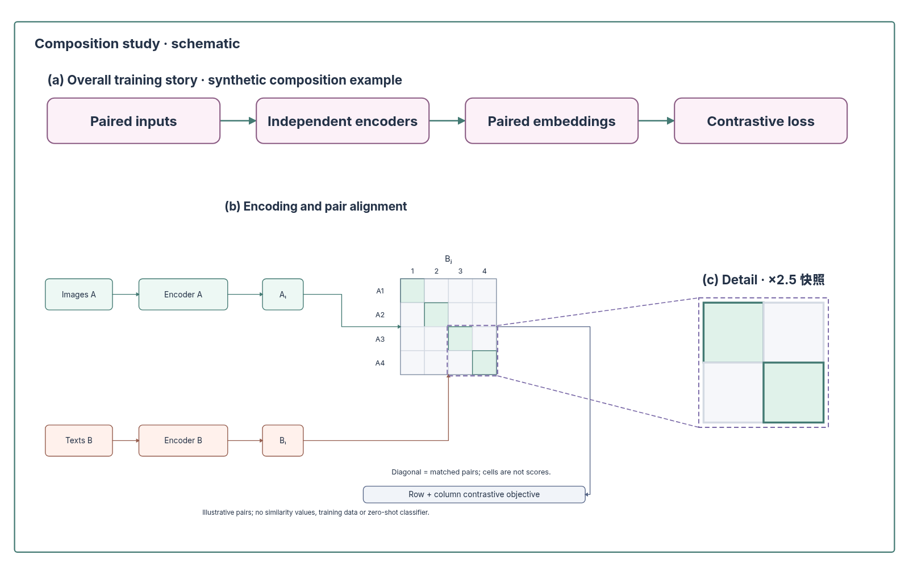

# 从经典论文结构到一张完整主图

2026-10-31，第八十六批。延续 FastPPT 原 PPT 对象与页面研究，补充原论文验证。重点是结构适配与叙事编排，而非模板数量。当前结构配方十二类，全部参数化组合十八种。

## 原文观察与接入

| 原文 | 图形作用与编排特点 | 本轮落地与边界 |
| --- | --- | --- |
| [FPN](https://arxiv.org/abs/1612.03144)，Fig. 2、Fig. 3、§3 | 多尺度全局布局与局部算子解释结合；层级、横向连接、逆向尺度传播共同表达机制，局部图解释上采样和相加。 | `feature-pyramid`：3–5 层；C 层 bottom-up、1×1 lateral、top-down 2× up、低层相加与输出 3×3 分开。无检测头，不填造特征尺寸；可变层数为示意变体。 |
| [CLIP](https://proceedings.mlr.press/v139/radford21a.html)，Fig. 1、Fig. 3、§2.2 | 双编码分支与配对矩阵结合；整张图分开说明预训练、分类器构造、预测阶段，跨阶段通过共享角色和表示对应。 | `dual-encoder-alignment`：3–5 个示意配对，双编码器、独立嵌入、配对矩阵与可选行列双向目标。仅抽象预训练；对角色标只表达配对身份，不是相似度值。不混入零样本分类流程。 |
| [U-Net](https://arxiv.org/html/1505.04597v1)，架构章节 | 对称的收缩／扩展与跨层对应需要与普通流程、FPN 横向加法区别。 | 已核对原文说明，列入后续结构研究；本轮未新增 U-Net 专用配方，也没有把 FPN 命名成通用 U-Net。 |

FPN 的同尺度融合与 CLIP 的配对身份不是可随意互换的“箭头＋矩阵”。必须保留箭头方向、操作符、阶段边界和符号语义。证据清单 [paper-structure-evidence.json](paper-structure-evidence.json) 保存原文地址、核对页与 PDF 指纹；本地阅读采用原 PDF 页面，应用不依赖这些文件，未打包第三方原图。以下为原生独立示意：

## 助手应如何组合

先写清一张图要回答的问题，拆出必要的信息作用，再选择结构。概览适合阶段或分层，机制可能需要双分支、张量、矩阵、反馈或多尺度关系；分类可用不均衡树，归属可用泳道，集合共性可用交叠。局部解释负责降低理解成本，不自动代表额外计算步骤。结构选择须服务真实内容，简单问题可以只用一种结构；不能为了多样性堆叠图标、模板或重复标题。

方案分区新增可检查的 `design`：

- `role`：overview、mechanism、detail、context、evidence；明确叙事作用。
- `structure` 与 `rationale`：声明结构族，并解释它为何适合该区及全图论点；具体复合关系可用 custom 详细描述。
- `emphasis`：恰有一个 primary，其他分区 supporting；比例、密度与阅读顺序共同体现主次，不以面积机械判定重要性。
- `frame`：唯一根级容器 ID 与根内容区的 0–1 坐标比例，各分区完整在内容区且不重叠；局部解释先留位置。
- `connections.kind`：dataflow、feedback、detail、comparison、membership，避免所有关系都画数据流箭头。

生成候选时，程序核对实际分区框位置／尺寸（2px 容差）、可见内容、素材实例归属；数据流和反馈需要方向正确的跨区语义边或双端绑定路径，局部对应需要无箭头双端绑定路径。方案界面展示结构理由、主次和相对版面。旧方案保留原来的文字布局，不强行迁移或据此宣称通过新检查。

对照／包含的科学含义、符号一致性、阅读效果与文字可读性仍需审阅。程序不证明选择最优、关系真实或达到论文发表质量，也不持续约束后续手工编辑；保存方案是当时的来源记录。

## 可重新生成的主图示例

示例把紧凑的阶段概览、双编码器／矩阵机制和实际选中矩阵局部组成一张图。主机制位于下方左侧，右侧以无箭头虚线解释真实 2×2 选区，复用原生颜色与几何。这里同一结构族在机制与局部之间重复是必要对应，不能为了“不同”改成另一种不相干图形。

[可编辑 FigureIR 工程](assets/composite-mainfigure.json) 可以从“工程 → 导入”打开。运行 `node --experimental-strip-types scripts/build-composite-example.mjs` 可重新生成工程和 SVG，使用实际配方、选区复制、方案解析与候选校验链路。示例内容为编排能力演示，无实验结果；这是程序构造的开发样例，未用来声称真实模型规划质量。

实际局部快照由人或助手在已有图件上调用同一 `detail-inset` 编译器；当前不能与采用方案／新实例生成混合提交。原图后续变化不会自动同步到快照，源选区框可能包围未选对象，副本只含实际选中项。证据保留源对象 ID、时间、倍率、未复制的外部边与解除的外部端点。

## 验证与下一批

593 项核心／服务检查、40 个文件，Lint、类型、生产构建通过；四条 1920×1080 桌面 UI 流程通过（本机 54.569 秒）。新增风险覆盖不均衡终端分支、局部真实内容／来源／撤销、图表局部与无空位拒绝、论文结构边界、复合方案分区／归属／有向关系／无箭头局部对应。另测六组默认或边界配置的浏览器实际字形范围；复合示例文字估算无省略，对应引线未经过未选对象。截图人工核对后保留。没有新增 UI 流程文件，没有运行新的真实模型评测。

后续继续按“原文验证—关系抽象—原生编辑—参数维护—复合主图实测”推进：优先多尺度编解码／跳连、残差与分支聚合、图消息传递、路由专家、训练／推理多阶段，以及与现有张量／注意力／结构配方之间的合理组合。尚未实现的类型不作为当前能力宣传。
