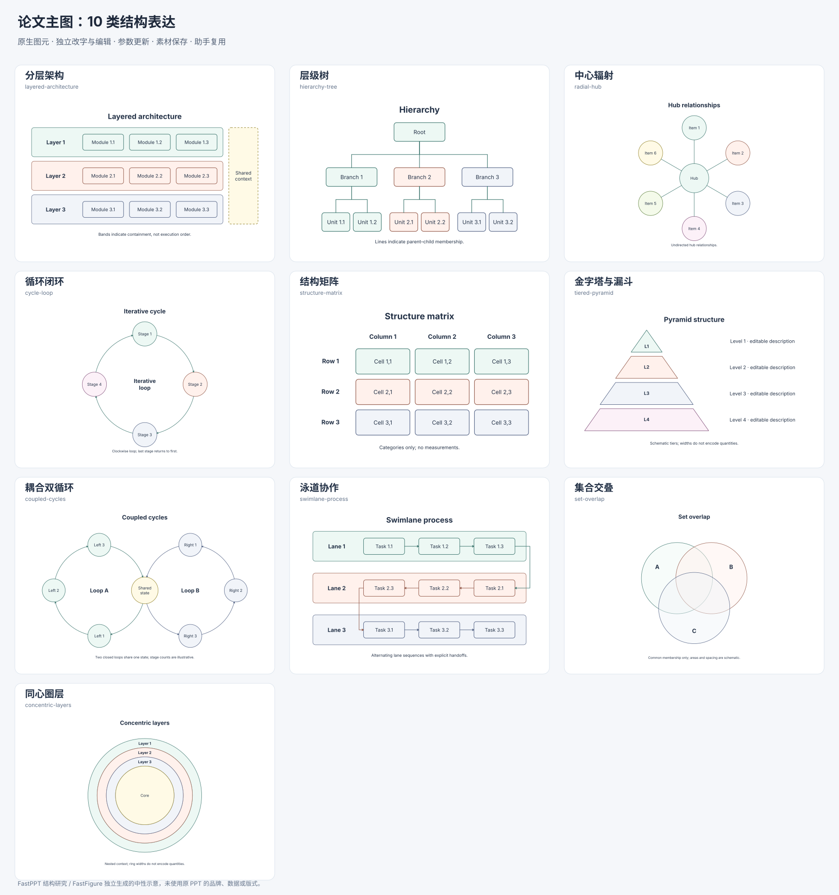

# 从 PPT 结构表达扩展论文主图

用户目标：论文主 figure 需要表达系统组成、模块分工、包含、层级、并列、反馈与局部展开。绘图系统需要把这些关系组织为可编辑的复合结构。

## 证据与检查范围

读取本机 `~/FastPPT/packages/resources/index.json`，目录包含 31 个原始 PPTX 来源的 3,497 页，其中 `diagram` 1,704 页、`layout` 1,793 页。检索标签包含流程 681 页、层级 638 页、关系 342 页、循环 214 页、矩阵 85 页、金字塔 59 页。同一页可有多个标签，这些是检索元数据，不能相加，也不是逐页视觉标注结果。

从 6 个 PPTX 中选取 9 页，读取原始 DrawingML 对象清单，并查看资源目录中对应的原始 PDF 页面。全部 6 个 PPTX 的文件 SHA-256 与素材 composition 来源记录一致。9 页中 3 页的 python-pptx 序列化 XML 摘要与 composition 记录不同，因此没有依靠 HTML anchor 对应来推断对象身份；分析以原始 PPTX 对象和所见页面为依据。现有 PDF 的新鲜度没有重新通过 Office 渲染确认。

完整指纹、对象数量、图形类型、分组、连接绑定和有限文字样本见 [ppt-structure-evidence.json](ppt-structure-evidence.json)。这是目录统计和代表性检查，未声称逐页视觉验收整个素材库。

| 资源 ID / 原始页 | 所见结构 | 对系统的启示 |
| --- | --- | --- |
| `11ebacee969e-0001`，architecture-deck 第 1 页，157 对象 | 横向体系条带、侧边资源池、内部流程与重复槽位 | 宏观分区、子模块、跨层区域应各自可编辑；外层框架不能被统一当成流水线 |
| `11ebacee969e-0013`，同源第 13 页，43 对象 | 多层平台、每层服务单元、宽度递变 | 层次与职责可由位置和包含表达；层间不必自动画箭头 |
| `11ebacee969e-0003`，同源第 3 页，76 对象 | 放射关系、卡片和右侧说明混排 | 主结构与解释区域需要组合；标题相似不能替代看图判断结构 |
| `a05afce176e0-0022`，绿色逻辑框架第 22 页，62 对象 | 一个根节点连接五个部门分支，各分支有内部说明 | 从属线应有端点绑定；布局方向与科学流向需要分开 |
| `4013c739f962-0001`，thesis-novice 第 1 页，37 对象 | 中心与六个周边单元，图标、标题与解释分开 | 需要径向排列与可明确选择的关系方向，图标不能替代结构 |
| `5e206af1d674-0008`，mckinsey-style 第 8 页，92 对象 | 双环／无穷形闭环、阶段标记、两侧解释 | 循环需要曲线、顺序和首尾关系；本轮先提供单环基础配方 |
| `e48d83706172-0018`，红蓝工作汇报第 18 页，68 对象 | 顶部目标列、下方策略与支持分区 | 需要列标题、行类别和独立单元，位置表达对照关系 |
| `34422534f8b5-0035`，premium-corp 第 35 页，89 对象 | 五层金字塔与右侧逐层说明对齐 | 闭合轮廓、内部标签、外侧解释需分别编辑，宽度不默认代表数据 |
| `5e206af1d674-0026`，mckinsey-style 第 26 页，130 对象 | 多级漏斗、侧向说明、重复单元 | 应支持轮廓切换及层级增减，不能从装饰漏斗推断真实转化率 |

对象数保留原检查器对 AlternateContent 的独立表示计数，不能直接理解为同时可见的图元数。原 PPTX 只读，没有复制第三方整页或图片进入产品。

## 功能特点与论文用途

这些页面的复杂度主要来自复合关系，而不是更多箭头样式。需要同时管理四个层面：整体阅读顺序，子结构的包含与并列，结构内部的重复规则，以及标签、解释、配色和接口。

1. **包含与分区。** 主 figure 的数据、模型、训练、推理等区域可以并排或分层；容器需要保存后代、独立标题和主题。跨层共享区表示职责范围，不能自动等同于执行步骤。
2. **重复规则与对应。** 层数、分支数、周边数、行列数变化会改变图元和几何；仍存在的单元要保持身份、人工改字和外部引用。图片整体缩放不能满足这个需求。
3. **关系种类。** 从属、无向关联、定向辐射、迭代反馈与数据流有不同含义。树线默认不带箭头，辐射默认无向；循环明确阶段顺序及返回关系。
4. **非矩形几何。** 圆周排列、贝塞尔弧、三角形与梯形轮廓需要进入原生路径模型，允许选中、改控制点与绑定端点。
5. **主结构与解释。** 内部标签、旁注和图例需独立编辑，解释区可与层级对齐。应用到论文时应使用作者提供的模块名称、公式和关系，避免沿用汇报页样例内容。
6. **组合与复用。** 结构图可以成为主图的一个区域，继续连接已有张量、注意力或图像分块组件。采集后保留来源和参数；助手与手工入口使用同一生成器。

现有系统已经提供原生路径、嵌套容器、主题／颜色映射、端点绑定、图元编辑、参数更新、局部采集和助手候选。此次在这些能力上增加结构配方和关系语义，没有引入第二套图形表示。

## 已接入的能力

| 配方 | 结构参数 | 图形与关系 |
| --- | --- | --- |
| 分层架构 | 2–5 层，每层 2–4 模块，可选共享区域 | 真实嵌套分组、可编辑层标签与模块；无隐式层间箭头 |
| 层级树 | 2–4 一级分支，每支 1–3 叶子，向下／向右 | 独立节点与绑定折线路径，默认无箭头 |
| 中心辐射 | 3–8 周边单元，无向／向外／向内 | 圆周布局、中心单元、绑定辐射线 |
| 循环闭环 | 3–8 阶段，顺／逆时针 | 单环、首尾闭合、独立贝塞尔弧与阶段标签 |
| 结构矩阵 | 2–4 行、2–4 列，可选行列标题 | 类别对照单元；没有预置观测、热度或相关性 |
| 金字塔与漏斗 | 2–5 层，金字塔／漏斗轮廓 | 闭合层片、层标与旁注；宽度仅示意 |

以上为首批六类结构。随后已加入[耦合双循环、泳道协作、集合交叠和同心圈层](2026-10-31-relational-structures.md)，目前共有十类。入口及编辑规则见 [论文结构图](../development/structural-figures.md)。以下总览随产品当前原生配方生成，可运行 `node --experimental-strip-types scripts/build-structural-overview.mjs` 更新。

## 尚未实现的范围

当前结构配方属于通用基础结构，未将 3,497 页自动转成组件，也没有直接 PPTX 导入、模板像素复刻或 PPTX 导出。树与分层配方使用统一重复数量；非均衡分支可插入后手工修改，尚无不规则树参数编辑器。共享状态双环、固定交接泳道、集合交叠和带孔同心环带已在后续批次加入。无穷形宽带、多中心交错、任意跨区交接、集合布尔运算、齿轮啮合和爆炸分解图仍需要进一步设计。

后续应优先补充可配置的局部解释与放大框、非均衡层级、跨区连接及复合主图编排，并以真实论文要求检查阅读顺序、最终字号和科学含义。装饰效果与无证据的定量编码不应优先于这些能力。
