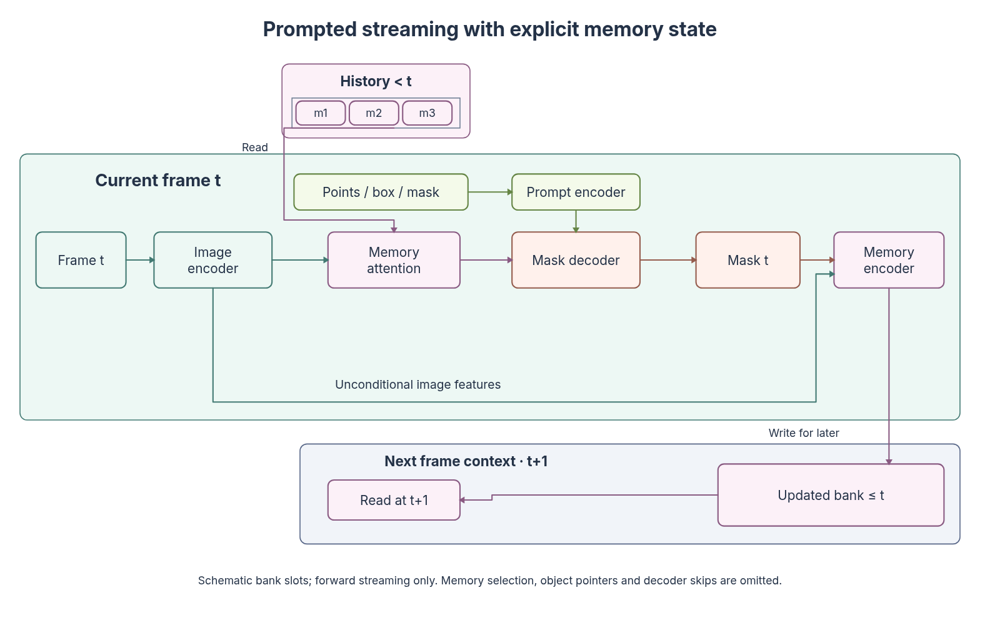
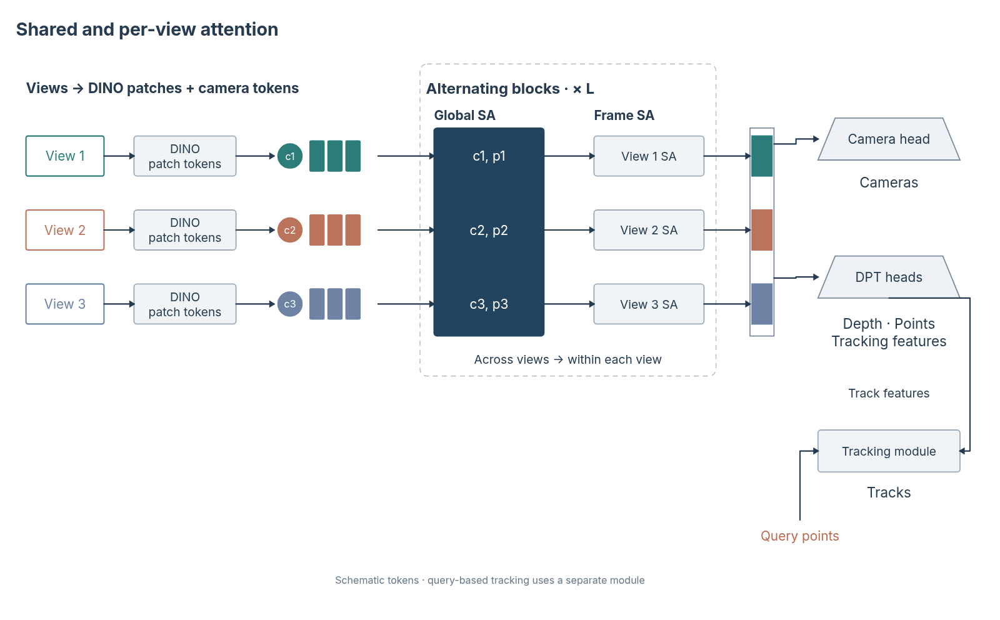

# 近期已录用论文主图：从叙事编排到原生结构

2026-10-31，第九十批。按用户最新优先级，重点转向近几年正式录用论文的主图，而不只继续收集经典网络模块。首批实际查看三篇 2024–2025 论文的首图及必要的架构图；录用依据来自会议论文集，不以预印本上传日期当作录用年份。核对记录、PDF SHA-256 和实际查看页见 [evidence](paper-structure-evidence.json)。

## 三篇图的作用与组合

| 论文与录用来源 | 实际核对 | 值得迁移的编排 | 接入方式 |
| --- | --- | --- | --- |
| [SAM 2 · ICLR 2025](https://proceedings.iclr.cc/paper_files/paper/2025/hash/45c1f6a8cbf2da59ebf2c802b4f742cd-Abstract-Conference.html) | Fig. 1、2、3；PDF 1、4、5 页，及 §4 | 首图让任务、模型和数据各司其职；任务用跨帧前后关系，模型用嵌套机制，数据用闭环。架构进一步用历史堆叠、提示旁路和跨时间记忆关系解释视频处理 | 新增 `streaming-memory` 原生配方；规划器接入 task/model/data 可选叙事策略 |
| [VGGT · CVPR 2025](https://openaccess.thecvf.com/content/CVPR2025/html/Wang_VGGT_Visual_Geometry_Grounded_Transformer_CVPR_2025_paper.html) | Fig. 1、2；PDF 1、3 页；§3.1–3.3 文本 | 首图以大场景建立视觉中心，辅以输入条带和输出对应；架构图保留视图身份，组合 token 行、跨视图共同块、逐视图独立块、重复括框和分型输出 | 新增 `alternating-view-attention` 原生配方；规划器接入共享核心／分型输出策略 |
| [DUSt3R · CVPR 2024](https://openaccess.thecvf.com/content/CVPR2024/html/Wang_DUSt3R_Geometric_3D_Vision_Made_Easy_CVPR_2024_paper.html) | Fig. 1；PDF 1 页 | 上部用短流程说明公共表示，再接不均衡任务树；下部对齐输入与不同结果表示。能力范围和实际证据互相补充 | 接入公共表示／任务树／证据策略，复用已有流程、非对称树和对齐编排；没有另加同义配方 |

这些是对图的编排分析，不是“录用由图造成”的因果判断。2026 论文需继续逐篇核对正式录用记录；本批没有把尚未核实的候选计入已录用样本。

## 两种可编辑机制

**时序记忆**不是画一个返回箭头。原生图把 `<t` 历史、当前帧和下一时刻上下文分开：旧记忆参与当前注意力；当前掩码和无条件图像特征共同进入记忆编码器；新状态 `≤t` 供之后读取。当前帧提示支路可显式省略。示意历史槽位可调 2–4，不等同于真实缓存容量。只展示前向流式抽象，省略对象指针、高分辨率解码跳连、掩码消歧及缓存选择策略。



[原生 JSON](assets/streaming-mainfigure.json) · [SVG](assets/streaming-mainfigure.svg)

**交替注意力**不是把每行画成互不相关的流水线。每个视图保持身份；一个共享 Global SA 覆盖所有行，随后各行分别进入 Frame SA；`×L` 框表示符号重复。相机 token 和图像 token 的消费者不同；稠密跟踪特征还需与查询点进入单独跟踪模块，不能把 tracks 描成主干的直接输出。视图数量 2–4 仅为示意；不填造维度、层数或场景。register token、首帧特殊身份及头内部细节未展开。



[原生 JSON](assets/multiview-mainfigure.json) · [SVG](assets/multiview-mainfigure.svg)

这些是独立构造的结构抽象。没有复制原论文照片、原始绘图、三维预测或实验值。图中的结果名称是类型说明。

## 助手能力落点

`mainFigureStrategies.ts` 中的三种策略进入真实方案规划提示，带来源、核对日期、适配条件、结构组合与所需用户信息。它们帮助助手先判断论文论点，再决定任务概览、主体机制、局部解释、任务树和证据各占什么位置；不强制所有图包含所有分区，也不以结构种类越多越好。

新配方同时进入目录、参数控制、`structureSemantics` 与 `compositionUse`。方案结构枚举增加 `temporal-memory`、`alternating-attention`；现有主次、分区坐标、实际跨区绑定及来源冻结约束继续执行。没有数据引擎就不能加入数据闭环；没有用户结果就不能补造定性结果。任务树中的“支持／派生”也不能自动改成并行神经预测头。

样例使用同一原生渲染器与严格方案核对器生成，保留可编辑图元、实际绑定、分区方案和来源。它们是程序构造的开发样例，不是已评测的真实模型自主规划结果。

## 检查与复现

新增两项有不同语义风险的资产检查：历史读取与后续写入、双输入记忆编码、可选提示及手工改字；跨／逐视图身份、跟踪查询依赖与 SVG 元数据往返。复用现有文件，不增加 UI 流程。另检查 2／4 槽位、提示开关、2／4 视图及两张实际组合图的浏览器字形。

```bash
node --experimental-strip-types scripts/build-composite-example.mjs --example=streaming
node --experimental-strip-types scripts/build-composite-example.mjs --example=multiview
node --experimental-strip-types scripts/build-structural-overview.mjs --ids=streaming-memory,alternating-view-attention --output=recent-structures-overview.svg
```

本批连同前一批阶段迁移共新增五项检查，当前 604 项、40 个核心／服务文件。最终桌面验收结果记录在[路线图](../development/roadmap.md)。
