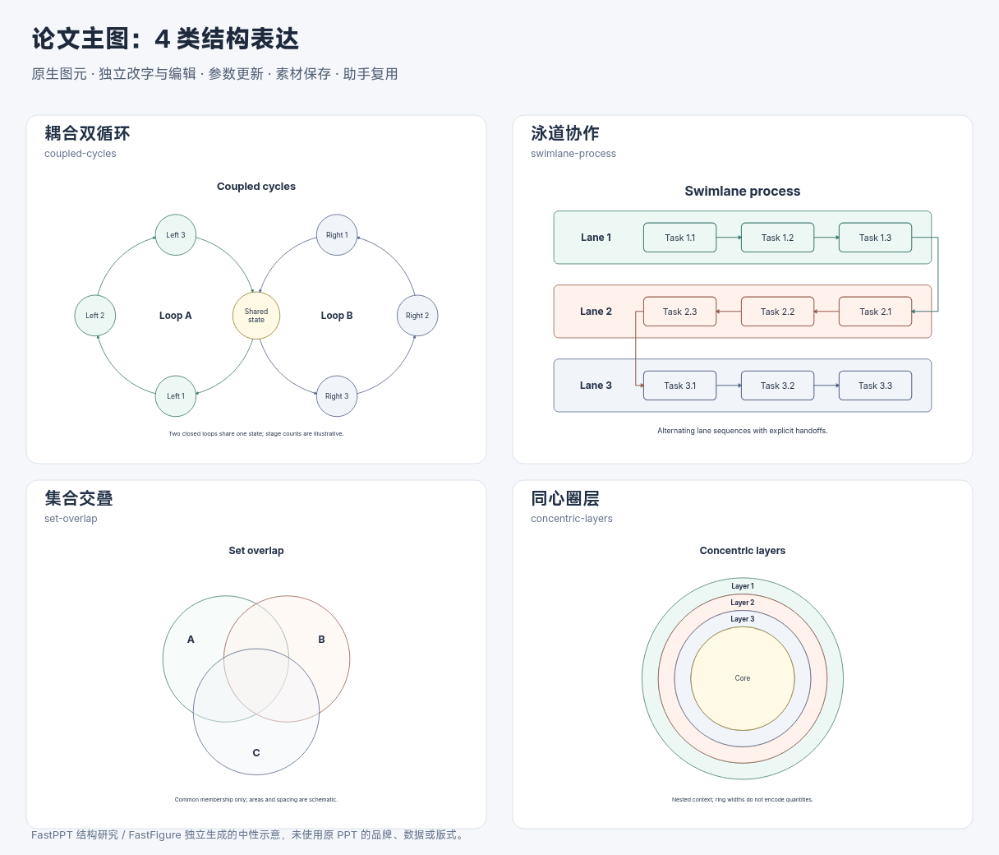

# 双循环、泳道、集合交叠与圈层

在首批六类论文结构基础上继续扩展四类关系表达。目标是让主图能展示耦合过程、任务归属、共同成员和多层上下文，并继续使用原生图元、明确的关系方向、可更新参数及稳定对象身份。

## 从原始对象到实际图形

本轮先检索资源标题，再从原始 composition 对象的圆形位置、大小和交叠关系筛选候选，最后查看源 PDF 页面并读取对应原始 PPTX。启发式筛选只用于找候选，没有把候选自动标为结构真值。

6 张采用的代表页来自 5 个原始 PPTX，文件 SHA-256 均与现有 composition 来源一致。证据见 [ppt-structure-evidence-v2.json](ppt-structure-evidence-v2.json)。PPTX 只读，未重新生成 Office PDF，也未依靠源对象到 HTML anchor 的映射断言身份。

| 原始页 | 检查结果 | 抽象到系统的能力 |
| --- | --- | --- |
| premium-corp 第 20 页，`34422534f8b5-0020`，92 对象 | 两个相互贯通的环形过程，中心交会，旁边有阶段说明 | 两个闭环共享一个状态，两侧单独计数与定向 |
| red-teaching-models 第 13 页，`39f4aad07819-0013`，74 对象 | 标题元数据提及同心圆，实际主结构是两个耦合环和中央区域 | 结构类别必须经看图确认；不能按标题自动生成同心圈层 |
| architecture-deck 第 2 页，`11ebacee969e-0002`，105 对象 | 阶段列与规划、目标、策略等职责行对齐 | 抽象分区归属和时序，独立构造带明确交接选项的泳道，不声称源图本身是交接泳道 |
| 700 页逻辑图形第 275 页，`f753356251a9-0275`，19 对象 | 两个半透明圆相交，内部文字和两侧标记独立 | 集合图形与标签分开，依靠真实透明叠色表达共同区域 |
| 天空蓝灵感手册第 16 页，`5eb4d31d8b16-0016`，86 对象 | 中心核心、多层同心圆和外围说明 | 抽象核心与环带的组织关系，生成可独立编辑的圈层 |
| architecture-deck 第 4 页，`11ebacee969e-0004`，92 对象 | 多个包含圆域、分层信息与外部解释 | 保留包含与上下文含义，不从大小推断数量或比例 |

这进一步说明：库里“结构特点”需要结合几何与实际视觉判断。标题中的循环、矩阵、层次等词适合检索，但不足以决定图形拓扑。业务内容和装饰效果没有进入配方，源图中的示例数据也没有变成论文事实。

## 已实现的关系约束

**耦合双循环**将共享状态保留为一个真实节点，两侧路径各自闭合。左右阶段数可分别选择 2–5。左环顺时针，右环可顺／逆时针；阶段和弧线的端点绑定明确。改变左侧数量不会重新命名右侧阶段。它表达共享状态的双环拓扑，尚不是原图的渐变无穷形宽带。

**泳道协作**用真实嵌套容器保存每个任务的归属。独立模式仅生成各道从左到右的序列；交接模式交替改变方向，并从前一道的最后任务连接到下一道的首任务。跨道线走侧边空隙，避免穿过任务内部。泳道数量为 2–4，每道任务 2–4；数量控制示意图元，不自动表示实际并发或资源分配。

**集合交叠**提供两集合／三集合及较窄／较宽交叠。独立集合圆使用半透明填充，名称放在独占区域，圆移动后仍以实际几何交叠显示。没有布尔交集对象、自动集合元素推断或面积比例，避免把示意面积当成数量。

**同心圈层**提供 2–5 条环带和独立核心。每个环带由两个闭合圆形子路径构成，采用 `evenodd` 填充形成真实孔洞，而不是用白色圆遮盖。标签可显示／隐藏。环带和核心可以分别编辑；手工移动不自动重新约束为同心。

四类都接入“论文结构图”分类、双语检索、助手结构语义、命名边界接口、参数更新、素材采集和原生 SVG。泳道切换模式时，任务身份按执行序号保留，人工文字／颜色跟随原任务；外部路径继续绑定同一任务，删除被引用任务时更新被拒绝。



## 验证与继续迭代

共用绘图函数提取前后，原有十二种配方的默认结果完全一致。现有资产测试文件增加五项独立风险检查，完整 587 项核心／服务测试及四条桌面 UI 流程通过，Lint、类型和生产构建通过。浏览器另外检查四类默认配置与四组边界配置的真实字形范围，不能将程序文字估算单独视为真实字体测量。

预览可由同一产品生成器重新生成：

```bash
node --experimental-strip-types scripts/build-structural-overview.mjs --ids=coupled-cycles,swimlane-process,set-overlap,concentric-layers --output=ppt-relational-overview.svg
```

下一步优先继续不均衡层级、局部放大／解释区及主图复合编排。无穷宽带、自定义集合运算、非均匀圈层、任意任务交接图仍没有专用参数编辑器。现有独立图元可手工编辑这些局部，但不能因此声称上述自动能力已经完成。没有执行新的真实模型质量评测或外部编辑器往返。
