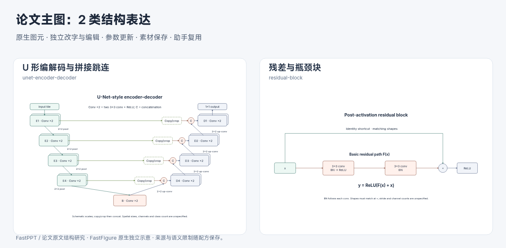
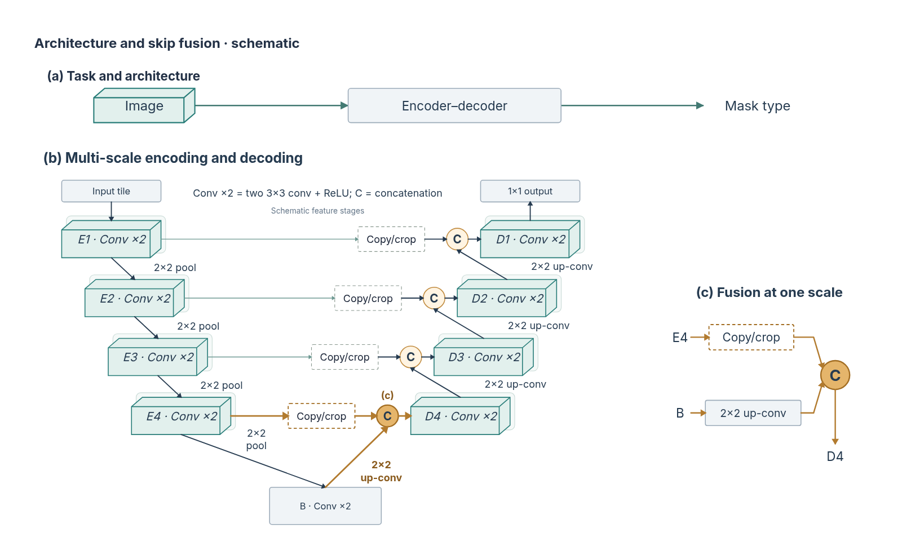

# 编解码、跳连与复合主图中的结构适配

2026-10-31，第八十七批。延续 [FastPPT 结构分析](2026-10-31-ppt-structure-figures.md) 与 [论文组合研究](2026-10-31-paper-composition.md)，本轮补充 U-Net、ResNet 的原文关系，以及助手在结构之间做选择的依据。

## 从论文抽象到可编辑图形

| 原文 | 保留的结构关系 | 本轮接入与边界 |
| --- | --- | --- |
| [U-Net](https://arxiv.org/abs/1505.04597)，Fig. 1、§2 | 收缩／扩展和一个共享瓶颈，各尺度通过复制／裁剪后拼接对应；池化与上卷积走不同方向，最后是输出映射。 | `unet-encoder-decoder`：3–5 个示意尺度（含瓶颈）；各阶段概括两次 3×3 conv+ReLU，明确 2×2 pool、2×2 up-conv、C 和 1×1 输出。原生特征背板、阶段、操作符、文字与绑定路径可分别编辑。不填造空间尺寸、通道数或分割结果，也不声称精确重现原文全部层。 |
| [ResNet](https://arxiv.org/abs/1512.03385)，Fig. 2、Fig. 5、§3.2–3.4 | 主分支和捷径在加法处汇合，随后激活。基础与瓶颈主分支不同；尺寸不兼容时可显式选择投影捷径。 | `residual-block`：basic / bottleneck、identity / projection；卷积后 BN，中间层含 ReLU，最后卷积到相加之间不加独立 ReLU。相加后输出激活。不代表 pre-activation 版本；尺寸兼容和投影为显式假设，步幅／通道未指定。 |

依据原 PDF 页面、图注和架构章节核对；地址、页码和 PDF 指纹保存在 [证据清单](paper-structure-evidence.json)。运行时不需要这些 PDF，也未打包原论文图像。以下是独立的原生示意：



“有跳连”不足以决定图形：U-Net 的 C 拼接、FPN 的逐层相加和残差的捷径相加承担不同任务。使用残差块替换另一架构中的阶段属于模型变更，不能由视觉相似性自动推出。

## 助手需要知道适配条件

现有二十种参数化组合均提供 `compositionUse`，包括结构族、适用的叙事角色、内容条件和误用边界。例如：阶段流程帮助建立概览；编解码展示尺度对应；残差块解释局部函数与捷径；张量补充表示组织；矩阵负责类别／配对等明确关系。共同进入清单不表示科学上可以直接连接。

主图／复合请求的自动推荐在原始相关性基础上对重复族做软降权，补缺时优先未出现族；普通查询和手选入口保持原路径。个人手改资产独立考虑，最多六项仍为候选。这个启发式不能判断科学兼容、完整约束或最佳版式，也不处理所有否定表达；助手必须说明选择原因并舍弃无关项。

## 完整主图：概览、尺度机制与局部汇合



[可编辑工程](assets/unet-mainfigure.json) 可从“工程 → 导入”打开。上方任务概览给出阅读入口，左下主区展示完整尺度关系，右侧解释最深解码尺度的双输入拼接。共享的 C、阶段标识和颜色把局部连接回整体；重复结构用于对应，不以结构种类多少评价好坏。

本页当前主图已按第九十五批的[实际审阅意见](2026-10-31-mainfigure-revision.md)更新：浅色概览、暖色代表性融合路径，以及明确标出 E4／B／C／D4 的局部机制解释。右侧重新组织已有输入、操作和输出，不声称是实际放大快照；同名阶段和 (c) 标记建立对应，不增加跨区计算箭头。原主架构的文本、几何与绑定保持。

此前真实选区快照版本固定保存在[第九十三批对照](2026-10-31-architecture-visual-design.md)，实际选区采集功能继续用于需要逐对象对照的场景。

重新生成：

```bash
node --experimental-strip-types scripts/build-composite-example.mjs --example=unet
```

同一构建器默认仍生成前一批双编码器示例。两个分支共用配方展开、方案解析和候选校验；双编码器仍用真实选区快照，U 形示例选择同名阶段的概念性解释，案例中的内容是程序构造的示意，没有实验结果，也不是新的真实模型编排评测。

## 验证与待续

旧十八种默认资产逐项保持。新增三项独立风险覆盖：U 形尺度与共享瓶颈、相加后激活／投影与外部引用保护、主图候选结构族／普通检索／手改内容保留。596 项核心／服务检查通过，Lint、类型和生产构建通过；四条 1920×1080 桌面 UI 流程通过，本机实测 58.354 秒。UI 沿用四条流程，无新增入口或逐按钮脚本。

另检查 U 形最小／最大尺度、基础恒等残差、瓶颈投影残差和实际组合主图的浏览器字形范围；组合图文字估算无省略、整理后的引线未穿过未选图元，最终截图人工核对。没有用测试通过来证明论文级美学或结构选择最优。

后续继续图消息传递、专家路由与训练／推理多阶段，补充有实际内容依据的组合案例和模型评测。
