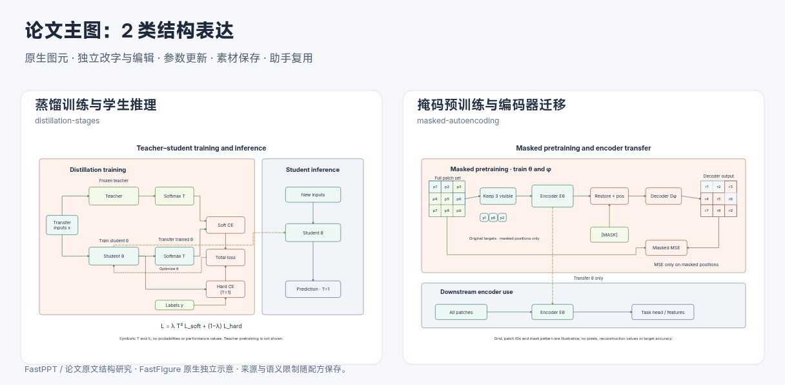

# 训练／推理阶段与参数迁移

2026-10-31，第八十九批。在此前结构库上增加两种阶段关系，为主图跨阶段编排提供明确语义。结构配方增至十八类、全部参数化组合二十四种；随后近期录用主图批次继续扩充，见[近期主图](2026-10-31-recent-mainfigures.md)。

## 依据与含义

[Distilling the Knowledge in a Neural Network · §2](https://arxiv.org/abs/1503.02531) 支持固定教师与可训练学生使用同一符号温度 T 的软目标、可选 T=1 硬目标和混合目标的 T² 平衡。独立构造的 `distillation-stages` 将训练分叉／目标合并和部署学生分区；优化只指向学生，部署虚线只传递训练后的学生 θ。仅软目标变体明确省略硬标签目标，没有伪造温度、概率、λ 或性能。

[Masked Autoencoders Are Scalable Vision Learners · Fig. 1 / §3](https://arxiv.org/abs/2111.06377) 支持可见块进入编码器、编码后加入掩码与恢复顺序、仅掩码位置重建损失及下游编码器迁移。`masked-autoencoding` 中输入／输出块以同一 ID 对应；网格与固定可见模式仅解释成员关系，不是实际采样比例、像素或重建结果。下游接收全体块，复用 Eθ，不迁移预训练 Dφ。



[蒸馏原生 JSON](assets/distillation-mainfigure.json) · [SVG](assets/distillation-mainfigure.svg)；[MAE 原生 JSON](assets/mae-mainfigure.json) · [SVG](assets/mae-mainfigure.svg)。原文 SHA 和查看页见 [evidence](paper-structure-evidence.json)。

## 系统接入

新增 `parameter-transfer` 方案关系，界面显示“参数迁移”。实际候选必须有可见、方向正确、单向虚线的跨区 edge 或双端绑定 path；实线、反向、双向、隐藏路径不能通过。规划和生成提示明确参数初始化与数据流的区别。程序检查几何和外观，不证明真实张量兼容或方法成立。

配方共用已有参数更新、采集重插和原生 SVG 工作流。阶段内部路径归属实际阶段容器，独立采集推理／下游阶段不会携带训练教师、损失或解码器。稳定模块的手工标签在参数调整后保留。

复用 `assets.test.ts` 的两项语义风险检查和 `compositionPlan.test.ts` 的一项真实参数迁移核对。浏览器检查硬目标开关、网格 2／4 与可见数量代表及两张原生主图字形；4×4 小块标签发现截断后减小内边距修复。完整检查合并在随后近期主图批次验收，没有新增 UI 文件或真实模型调用。

```bash
node --experimental-strip-types scripts/build-composite-example.mjs --example=distillation
node --experimental-strip-types scripts/build-composite-example.mjs --example=mae
```
