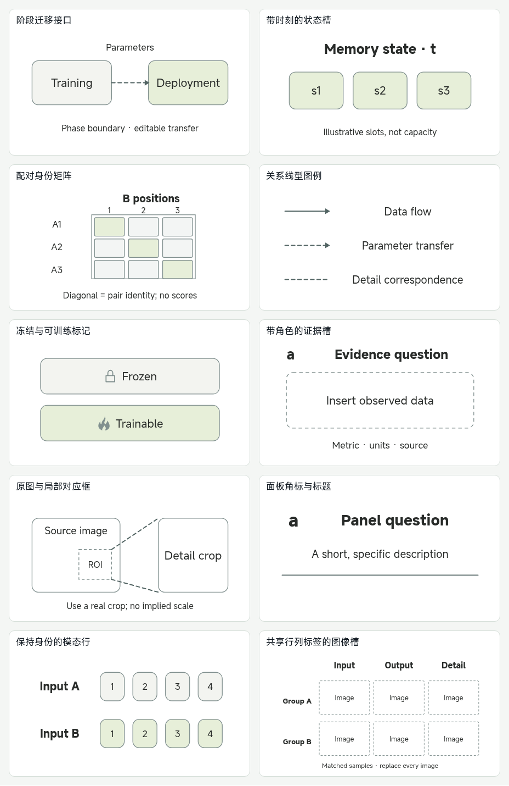
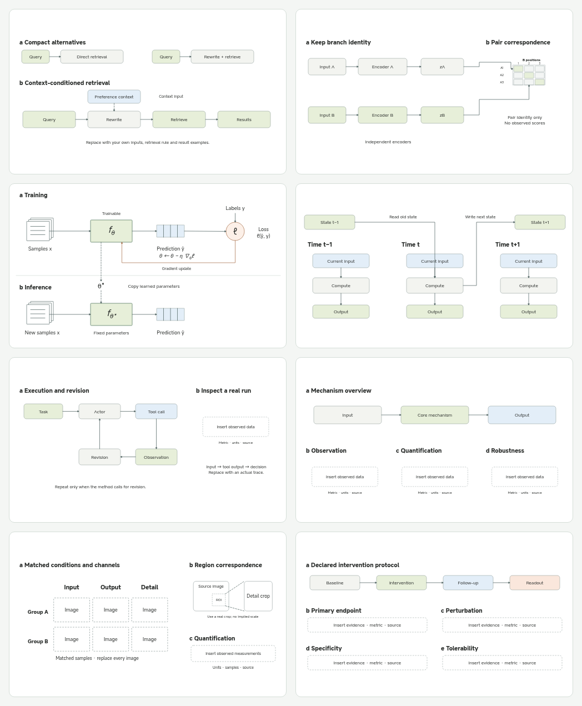
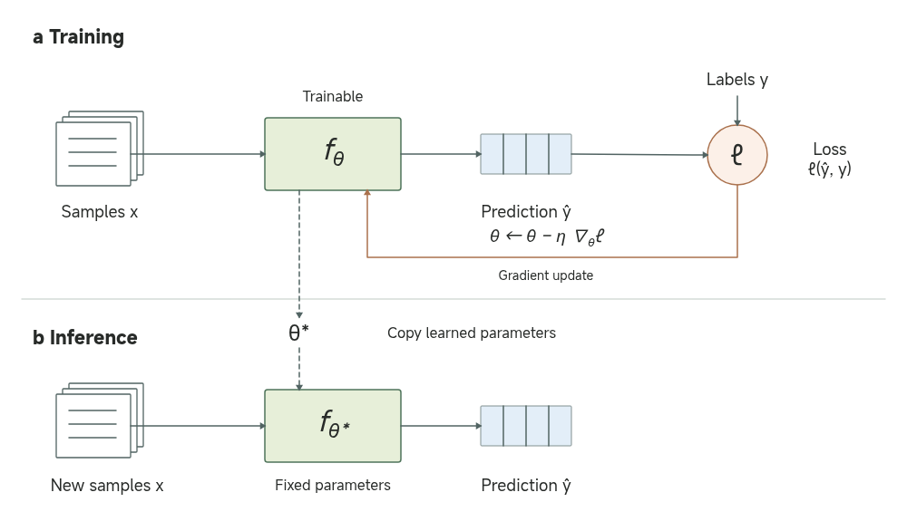

# TopConf / FigureForge 逐图结构阅读与主题扩展

2026-11-07。延续项目中固定的两个上游版本，实际读取图片，而不是根据索引标题生成组件。新增 10 个基础构件、8 个主题组合，并把训练部署主题从通用框图改成有明确计算关系的监督学习示例。

## 覆盖范围与阅读深度

| 集合 | 固定版本 | 实际读取 | 记录方式 |
| --- | --- | --- | --- |
| TopConf | `77a7d84570a6a9f3e63c22bb31b9fb59757e3dab` | 索引对应的全部 3,449 张 JPEG，逐图记录视觉结构；其中 9 张另行放大阅读 | [逐图台账](gallery-study/topconf.json)：ID、原路径、SHA-256、联系表页码/格位、视觉代码、阅读层级与详细笔记 |
| FigureForge / nature-figure-skill | `af778027c866e2e6b3432b946e44a4a2b4434d82` | 仓库内全部 66 个 PNG/SVG 文件，以及现有固定资源中的 22 个模板 SVG | [逐项台账](gallery-study/figureforge.json)：路径/模板 ID、SHA-256、单项观察与采用/排除理由 |

这里的“逐图”是**构图与结构层面的完整覆盖**：TopConf 依索引顺序制成 72 张联系表，每页至多 48 张，每格保留图件身份，逐格查看并记录；不是逐篇论文的方法精读或逐字 OCR。联系表里的小字不能作为算法细节的依据，未放大图件的记录统一标为 `layout`。9 张选定原图的详细观察标为 `detail`。这些代码是本次人工视觉观察，没有把上游类别自动充当阅读结论。

FigureForge 的 66 个文件包括宣传界面、封面、SVG/PNG 同图版本、图表展板和复合主图；同图的两个文件分别记账，但不计为两个独立设计。10 张 chart-atlas 各含 16 个小面板，逐板查看；5 张 rich gallery 另行放大。其余文件与 22 个模板逐项查看于联系表。宣传编辑器截图、封面不提取为科研组件。所有示例统计图只借鉴面板组织，不反推真实数据。

原图下载、解码及 SHA-256 已核对。原始图片和联系表放在被忽略的 `test-results/gallery-study/`，不随产品或文档捆绑论文图片。可复核的逐图台账与本项目重新绘制的原生图件进入仓库。

## 从原图得到的设计判断

### TopConf 的九个放大案例

| 原图 ID | 观察到的组织方式 | 保留什么 / 舍弃什么 |
| --- | --- | --- |
| aaai2023-25392 | 三时刻主轴，中间强调；时间线、连接、模态 token 各有编码 | 时间列对齐、模态身份、集中图例；不继承模型内部含义 |
| aaai2023-25531 | 镜像双域与内部子区；跨域细弧不同于本域计算 | 双路身份和跨路关系；不沿用隐私与融合公式 |
| aaai2025-32774 | 上下方法共享阶段列；反馈回到前轮模型 | 共同列轴与真实回返方向；不把反馈误称参数迁移 |
| aaai2026-37741 | 两种紧凑检索对照之下展开主方法 | 对照层与主路径层的面积差；不复制例子的优劣判断 |
| acl2024-2024.acl-long.570 | 试错闭环、短/长期记忆、经验整理分区 | 执行与归档分开；不把所有线都画成同一种循环 |
| iclr2024-0825 | 训练独有感知支路与部署分区，中间明确迁移 | 阶段边界、参数迁移；不把来源的特定算法简化成同名复刻 |
| iclr2025-1473 | Actor / Evaluator / Self-reflection 主循环，工具与运行实例分区 | 主循环加可核对的运行记录；不编造工具结果 |
| icml2024-0608 | 三种记忆并列，槽位与关联网络采用不同形态 | 存储角色与状态身份；格数不解释为真实容量 |
| icml2026-0316 | 训练与测试时更新方式对照，区分冻结/可学习模型 | 更新位置与状态标记；不复制来源的优化公式 |

原论文链接和固定原图链接保存在台账对应 ID 的上游索引，以及组件的来源记录中。选用的 17 项来源另存为小体积运行时清单 `src/data/materials/gallery-study-sources.json`，包含原图 SHA-256。

### FigureForge 的组织规则

- 图像板：条件作为行、通道作为列，共享标签；局部裁切通过 ROI 和对应引线解释。
- 机制主图：主机制占大面积，观察、定量和稳健性各承担一个证据角色；不能把多个空框称作验证结果。
- 干预验证：流程、主终点、干预证据、特异性与耐受分区。阶段间距不代表时长，面板排列不证明因果。
- 图表 atlas：共享轴、图例位置、分面和标注密度可复用；曲线、点、误差线、样本量和显著性不能从宣传示例移植。
- 模板原生化沿用现有转换链；`violin` / `comp-ab` 的负高度几何仍不开放，没有以本次阅读绕过原有检查。

## 基础构件与主题组合

入口是“组件 → 基础 → 图库提炼 · 基础构件”和新增的“组件 → 标杆主题”。基础构件进入现有组件检索；完整组合需要主动选择或保存成自己的组件后再用于助手，不挤占已有个人素材的最近使用推荐。

| 基础构件 | 可独立改动的部分 | 主要约束 |
| --- | --- | --- |
| 阶段迁移接口 | 阶段块、迁移线、参数标签 | 虚线箭头明确表示参数复制 |
| 带时刻的状态槽 | 时刻、槽位与注释 | 槽数是示意 |
| 配对身份矩阵 | 行列身份、配对对角线 | 空白类别格，不是有观测值的热图 |
| 关系线型图例 | 数据流、参数迁移、对应引线 | 根据实际关系修改图例 |
| 冻结与可训练标记 | 图标与文字 | 状态需显式声明 |
| 带角色的证据槽 | 角标、问题、数据位置、说明 | 数据位置留空 |
| 原图与局部对应框 | 源图槽、ROI、局部槽、引线 | 必须使用真实裁切 |
| 面板角标与标题 | 角标、标题、说明、分隔线 | 适用于开放图版 |
| 保持身份的模态行 | 两行身份、token 位置 | 不暗示共享编码器 |
| 共享行列标签的图像槽 | 条件、通道、各图像槽 | 不合成图像或比例尺 |



| 主题 | 组合关系 | 内容状态 |
| --- | --- | --- |
| 检索改写 | 紧凑替代方案 + 展开的上下文条件主路径 | 布局骨架，需补实际查询、规则与结果 |
| 双路表征 | 保持输入身份的两条编码路径 + 配对矩阵 | 布局骨架，矩阵不含分数 |
| 训练部署 | 相同计算轴的训练/推理 + 标签损失 + 梯度回路 + 参数复制 | 明确的监督学习示例 |
| 时序记忆 | 三时刻输入/计算/输出 + 读旧状态、写新状态 | 布局骨架，需补实际状态与计算 |
| 工具反馈 | 执行修订闭环 + 实际运行记录位置 | 布局骨架，不含工具输出 |
| 机制证据 | 宽机制概览 + 观察/定量/稳健性证据 | 布局骨架，不含实验结果 |
| 图像对照 | 共享标签的条件×通道图版 + ROI 对应 + 定量 | 布局骨架，不含图像与测量 |
| 干预验证 | 协议阶段链 + 四类证据包 | 布局骨架，不含医学数据 |



所有对象均为原生文字、形状或路径；参数转移、梯度回路、状态读写和数据线保留节点绑定。可整体缩放、改字、移动、采集、保存、再次插入和撤销；不把整幅参考图伪装成可编辑组件。说明与来源放在库和元数据中，避免堆进论文出图。

## 为什么初版训练部署图显得模板化

用户指出的初版存在可见缺陷：外部标题、内部标题重复；大边框再套小圆角框；几乎所有对象采用同一种形态；主文字偏小，空白又占据主面积；`Trainable model`、`Declared objective` 等标签没有说明计算关系。训练支路最终只落到一个目标框，读者看不到预测、标签、损失或参数更新。颜色也没有稳定承担数据、模型和操作的角色。这些特征共同产生“AI 感”，仅靠换配色或加图标不能解决。

新版先选择具体表达对象——普通监督学习——再组织图件：

1. 训练与推理共享样本 → 模型 → 预测的横向计算轴。样本使用片层、预测使用向量格、模型使用模块、损失使用运算节点，形态承担对象类型。
2. 标签只接入训练损失；损失通过暖色回路更新训练模型，并标注梯度更新式。用虚线把学到的参数复制到固定参数的推理模型；两种关系没有混用。
3. 只保留两个阶段标题和必要符号；统一英文图内标注，公式用可编辑上下标；去掉装饰外框、重复标题和通用使用说明。
4. 把“内容示例”与“布局骨架”写进主题库。空证据槽只有构图价值，不能用模板数量代替科研主图的完成度。



该图是本项目重新绘制的监督学习说明，不复刻来源论文的训练算法，也不表示它们都使用普通梯度下降。使用其他方法时需要修改样本类型、模型、更新规则和迁移对象。

默认绘图、方案规划、图像草稿、风格说明及独立审阅已同步采用这些表达规则，并取消强制全区居中和对称；具体入口、作用范围与验证见[默认表达与风格约束](../development/figure-expression-defaults.md)。

## 可复核产物与验证

- `gallery-study/topconf.json`、`gallery-study/figureforge.json`：逐图/逐文件台账。联系表位置允许重新定位原图，`level` 区分结构阅读和放大观察。
- `src/data/galleryStudy.ts`：原生构建与来源；`galleryPrimitives.ts`、`galleryBenchmarks.ts`：10 个构件、8 个主题定义。
- `assets/gallery-study/`：18 项实际生产渲染器生成的 PNG、带工程元数据的 SVG 和工程 JSON；另附概览与 `validation.json`。
- `scripts/gallery-study.py`：核对完整索引、顺序、哈希与阅读记录；可按固定版本重取原图、重建联系表。脚本不生成视觉阅读标签。
- `scripts/build-gallery-study.mjs`：生产 SVG 导出 + Chromium 实际 MiSans 字体排版检查；18 项均无文字截断报告。已查看概览与修订图，修正对角线颜色、ROI 标签重叠、重复标题及损失标签穿线。

复现命令：

```sh
python scripts/gallery-study.py
# 可选：取回固定原图并重建联系表；需要 Pillow 和 rsvg-convert
python scripts/gallery-study.py --fetch --sheets
node scripts/build-gallery-study.mjs
pnpm test
pnpm lint
pnpm build
node tests/ui/run.mjs --gallery-study
```

本次 47 个测试文件、655 项单元测试通过；lint、包含类型检查的生产构建通过。新增单元检查覆盖来源、原生解析、禁止伪造图像/统计图、重复插入的独立绑定、改字后的捕获、状态读写方向与训练梯度/参数转移。专项 1920px 浏览器流程覆盖构件/主题搜索、默认比例、完整插入、来源保留及撤销。

完整 `pnpm test:ui` 在帮助图标尺寸断言处失败：当前工作区的 `workspace.css` 把帮助图标改成 18px，已有断言要求接近 30px 头像大小；这处并行存在的样式修改没有在本次覆盖。专项浏览器流程与完整桌面回归的结果分别报告，不把专项通过说成全部通过。

上游代码许可与原图权利分别处理。组件保留作者/仓库来源、固定版本和图片指纹；这里只抽象布局、关系与视觉语法，没有复制论文图片、示例实验值或临床结论。
